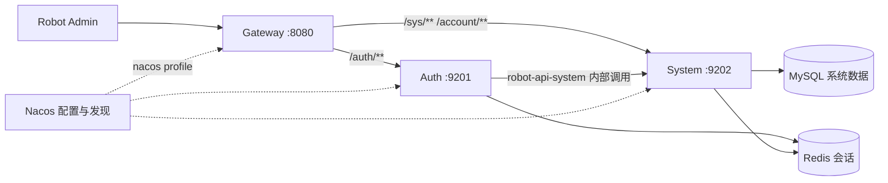

<div align="center">
  <picture>
    <source media="(prefers-color-scheme: dark)" srcset="docs/assets/brand/lockup-dark.svg">
    
  </picture>

  <p><strong>面向 Robot Admin 的 Spring Cloud Alibaba 后端框架</strong></p>
  <p>认证 · 公司上下文 · 系统管理 · 权限治理</p>

  <p>
    <a href="robot-dependencies/pom.xml"></a>
    <a href="robot-dependencies/pom.xml"></a>
    <a href="robot-dependencies/pom.xml"></a>
    <a href="LICENSE"></a>
  </p>

  <p>
    <a href="#本地构建与启动">快速开始</a> ·
    <a href="docs/architecture.md">架构与演进</a> ·
    <a href="docs/api-contract.md">API 契约</a> ·
    <a href="docs/review-2026-10-14.md">全面审查</a> ·
    <a href="docs/improvement-roadmap.md">改进台账</a> ·
    <a href="https://github.com/ChenyCHENYU/Robot_Admin">Robot Admin</a>
  </p>
</div>

---

## 项目定位

Robot Cloud 为 Robot Admin 提供认证、公司成员、组织与权限管理能力。当前采用 Gateway、Auth、System 三个运行服务，配合统一的公共组件、API 契约和依赖 BOM；System 内保留相关业务的本地事务。

- Maven 坐标：`com.robot:robot-cloud:1.0.0-SNAPSHOT`
- 运行服务：`robot-gateway`、`robot-auth`、`robot-system`
- 工程组织：独立服务、五个公共组件、跨服务 API、统一依赖 BOM。
- 演进方向：先巩固内部业务边界和持续验证，再按数据所有权、容量及独立部署需求拆分。

最近一次完整审查为 **2026-10-14**，业务源码基线为 `29c42aa`。[全面审查](docs/review-2026-10-14.md)登记 REV01–REV24，覆盖架构、功能、授权、认证、数据库、性能、配置和交付；当前没有这些项的后续修复提交或验收记录，均保留待处理。优先级、产品决定及环境依赖见 [改进台账](docs/improvement-roadmap.md)，分批实施和完成标准见 [执行计划](docs/review-execution-plan.md)。

该次默认验证通过 305 项 Java 测试、23 项 Python 测试及 17 个打包 Mapper 检查；独立探针仍发现未覆盖的缺陷。原生 BD 扫描有 74 项 error，完整基线审查无新增阻断，不能等同全部规范通过。真实 MySQL 升级、Admin 页面联调和生产 HA 未在该次审查重跑。文档复核取得 [verify 失败注释](https://api.github.com/repos/ChenyCHENYU/Robot_Cloud/check-runs/114446067171/annotations)：GitHub 账号因计费问题锁定，job 未启动，不能记为托管构建通过或源码构建失败。

[2026-10-09 历史验收](docs/verification-2026-10-09.md)单独保留当时的升级和隔离运行结果。[架构与演进](docs/architecture.md)描述设计与拆分路线；[API 契约](docs/api-contract.md)说明 Robot Admin 的请求字段、权限和兼容要求。

## 目录

- [能力与边界](#能力与边界)
- [服务拓扑](#服务拓扑)
- [工程结构](#工程结构)
- [技术基线](#技术基线)
- [本地构建与启动](#本地构建与启动)
- [配置约定](#配置约定)
- [Robot Admin 配对](#robot-admin-配对)
- [持续验证与数据库升级](#持续验证与数据库升级)
- [缓存通知与运维](#缓存通知与运维)
- [开发约定](#开发约定)
- [分支与协作](#分支与协作)
- [下一轮改进](#下一轮改进)
- [文档导航](#文档导航)

## 能力与边界

| 能力 | 当前行为 |
| --- | --- |
| 认证 | 密码登录、多公司激活、设备独立上下文、刷新令牌轮换与注销 |
| 撤销 | 账号/成员安全版本核验；改密、停用或移出后旧凭据失效 |
| 成员 | 平台账号和公司成员分开维护；当前公司成员查询、编辑、启停和移出 |
| 授权 | 有效永久/临时角色；页面与按钮精确绑定；管理授权受永久权限上界约束 |
| 数据范围 | 用户列表和详情执行本人、部门、下级部门及当前公司全量范围 |
| 系统资源 | 角色、菜单、按钮、部门树、字典、权限目录与审计 |
| 并发控制 | 编辑提交版本；用户启停/移出、角色删除提交 `expectedRevision`，拒绝旧页面操作 |
| 缓存一致性 | 数据库 epoch 为权威；业务、审计、epoch 与 Outbox 同事务，Redis 通知可重试 |
| 验证与观测 | 行为/架构测试、机器契约、迁移/制品检查、升级验收、Prometheus 与 TraceId |

通用字段权限、复杂工作流、业务消息平台、文件服务和完整 Redis HA 恢复属于后续建设。可选依赖登记或配置文件存在不能单独证明运行能力。

已有能力仍有具体缺口：全局资源的写入授权边界待收口；菜单移到根级可能未持久化，动态路由名可能冲突；菜单/按钮/字典删除及移动的客户端版本保护未完整实现。公司成员尚无独立部门事实，Admin 的用户/角色命令与部分治理接口也未完成真实配对。详见 [审查发现](docs/review-2026-10-14.md#findings)。

## 服务拓扑



网关处理路由、内部身份头清洗与请求跟踪。实际登录态、主体有效性和业务权限在服务侧校验；System 是系统数据属主，Auth 经 API 调用 System。

| 服务 | 默认端口 | 职责 | 网络边界 |
| --- | --- | --- | --- |
| `robot-gateway` | 8080 | API 入口、路由、Bearer 头检查、TraceId、内部路径阻断 | 反向代理提供 TLS |
| `robot-auth` | 9201 | 登录、上下文、刷新族与注销 | 应用内网 |
| `robot-system` | 9202 | 账号/成员、组织、权限、资源、审计和缓存控制 | 应用内网 |

## 工程结构

```text
Robot_Cloud/
├── robot-dependencies/          版本 BOM
├── robot-common/
│   ├── robot-common-core/       Result、分页、错误码、断言、摘要
│   ├── robot-common-web/        MVC、异常、JSON、TraceId
│   ├── robot-common-security/   登录态、族校验、内部信任
│   ├── robot-common-mybatis/    公司隔离、审计、分页、乐观锁
│   └── robot-common-redis/      序列化、缓存、原子操作、锁
├── robot-api/
│   └── robot-api-system/        Feign 与跨服务 DTO
├── robot-gateway/
├── robot-services/
│   ├── robot-auth/
│   └── robot-system/            系统业务与 Flyway 迁移
├── contracts/                   机器接口与数据合同
├── scripts/                     本地和 CI 共用入口
├── .github/workflows/           CI 定义
└── docs/                        架构、接口、部署、运行说明
```

服务之间不依赖实现 jar；common/API 不反向依赖 Auth/System。System 内按业务子域分包，角色查询、角色写命令和临时授权命令分开承担职责。

## 技术基线

版本以 [robot-dependencies/pom.xml](robot-dependencies/pom.xml) 为准。升级须联合验证框架兼容性、行为和制品依赖。

| 项目 | 仓库基线 |
| --- | --- |
| Java | Java 17 编译目标；CI 配置 JDK 17，本地验证使用 JDK 21 |
| Spring Boot | 3.2.12 |
| Spring Cloud / Alibaba | 2023.0.3 / 2023.0.3.3 |
| 认证 | Sa-Token 1.44.0、Bearer、token Session |
| 持久化 | MyBatis-Plus 3.5.12、MySQL、Flyway |
| Redis | Spring Data Redis；Redisson 3.44.0 + `redisson-spring-data-32` |
| 配置/流控 | Nacos、Sentinel，按 profile 启用 |
| 文档/监控 | OpenAPI 3、Knife4j、Actuator、Micrometer/Prometheus |

上述版本是仓库现状。Boot 3.2.12 是 3.2.x 最后一个 OSS 补丁，Cloud 2023.0.x 已结束支持，分别见 [Boot 官方公告](https://spring.io/blog/2024/11/21/spring-boot-3-2-12-available-now/)和 [Cloud 支持表](https://spring.io/projects/spring-cloud/)。实际 Security 6.2.8 落在 [BCrypt 安全公告](https://spring.io/security/cve-2025-22228/)影响区间。兼容升级、SBOM 和漏洞扫描仍待实施，见 [依赖维护项 REV18](docs/review-2026-10-14.md)。

## 本地构建与启动

### 环境与构建

准备 Maven、真实 JDK、MySQL 与 Redis。默认 `local` 使用 HTTP 直连，关闭 Nacos/Sentinel；数据库与 Redis 仍是必要依赖。

```bash
# 替换实际 JDK 根目录；macOS 通常以 Contents/Home 结尾
export JAVA_HOME="/path/to/jdk"
export PATH="$JAVA_HOME/bin:$PATH"
java -version
mvn -version
mvn clean verify

# 完整门禁：构建、契约、迁移清单和打包 Mapper 检查
bash scripts/verify.sh
```

### 数据库与配置

新环境创建空库；已有库按升级流程处理：

```sql
CREATE DATABASE robot_cloud
  CHARACTER SET utf8mb4 COLLATE utf8mb4_general_ci;
```

在三个进程中注入一致的 Redis、环境段与内部密钥；数据库配置用于 System：

```bash
export SPRING_PROFILES_ACTIVE=local ROBOT_ENV=local DEBUG=false
export MYSQL_HOST=127.0.0.1 MYSQL_PORT=3306 MYSQL_DATABASE=robot_cloud
export MYSQL_USERNAME="<local-user>"
# MYSQL_PASSWORD 从受控本地配置注入，不提交 .env
export REDIS_HOST=127.0.0.1 REDIS_PORT=6379 REDIS_DATABASE=0
# ROBOT_INNER_SECRET 使用三个进程一致的受控密钥
export SPRING_FLYWAY_BASELINE_ON_MIGRATE=false
```

System 从迁移目录应用未执行版本，`baseline-on-migrate` 默认关闭。非空且无 Flyway 历史的库需先评审；不改写已发布迁移，不用 repair 绕过未解释的校验和差异。

### 启动与检查

三个终端按 System → Auth → Gateway 顺序启动：

```bash
java -jar robot-services/robot-system/target/robot-system-1.0.0-SNAPSHOT.jar
java -jar robot-services/robot-auth/target/robot-auth-1.0.0-SNAPSHOT.jar
java -jar robot-gateway/target/robot-gateway-1.0.0-SNAPSHOT.jar
```

```bash
curl -fsS http://127.0.0.1:9202/actuator/health
curl -fsS http://127.0.0.1:9201/actuator/health
curl -fsS http://127.0.0.1:8080/actuator/health
```

随后验证登录、公司激活和受保护接口。开发种子账号为 `admin/admin123`；生产应替换开发凭据，当前未实现强制首次改密。

```bash
curl -sS -X POST http://127.0.0.1:8080/auth/login \
  -H 'Content-Type: application/json' \
  -d '{"username":"admin","password":"admin123"}'

curl -sS 'http://127.0.0.1:8080/sys/users?page=1&pageSize=10' \
  -H 'Authorization: Bearer <access-token>'
```

同时检查 HTTP 状态与 `Result.code`。登录可能直接返回会话，也可能要求使用一次性票据选择公司；health UP 不能替代业务验收。

## 配置约定

| 配置 | 用途 |
| --- | --- |
| `SPRING_PROFILES_ACTIVE` | 默认 local；nacos 开启配置与发现 |
| `MYSQL_HOST/PORT/DATABASE/USERNAME/PASSWORD` | System 数据源 |
| `REDIS_HOST/PORT/PASSWORD/DATABASE` | Auth/System 连接；空凭据不发送空 AUTH |
| `SPRING_DATA_REDIS_USERNAME` | 可选 Redis ACL 用户名，按 Spring Boot 标准属性注入 |
| `ROBOT_ENV` | 自定义 Redis key 环境段，需显式设置 |
| `ROBOT_INNER_SECRET` | 内部共享服务密钥，生产覆盖开发默认值 |
| `ROBOT_AUTH_URI/ROBOT_SYSTEM_URI` | local 网关 HTTP 目标 |
| `ROBOT_SYSTEM_URL` | local Auth 的 remoteSystemService Feign 目标 |
| `NACOS_SERVER_ADDR/NACOS_NAMESPACE` | 配置/发现地址与环境 |
| `ROBOT_CORS_ORIGINS` | 前端 origin 白名单 |
| `DEBUG` / `LOGGING_LEVEL_*` | 控制框架日志；不要在认证环境开启请求/响应载荷调试 |

nacos group 为 `ROBOT_CLOUD`，每个服务读取各自 YAML dataId。导入为 `optional:`，远端配置加载、注册及规则需单独验收。生产应限制 Actuator/OpenAPI 网络访问，分离迁移与运行账号，配置数据库 TLS、Redis ACL 和密钥轮换。

详细默认值和受控切换步骤见 [部署与运维](docs/deployment.md)。

## Robot Admin 配对

前端使用远端认证模式，以网关为 API 入口：

- 登录处理直接会话与多公司票据两种结果；合并同设备并行刷新。
- 页面与按钮分别消费精确权限，导航祖先不代表页面授权。
- 编辑保留 `revision`、`membershipRevision`，避免表单映射丢失。
- 用户启停/移出的 `expectedRevision` 来自 `membershipRevision`；角色删除来自角色 `revision`。
- 重置密码提交账号 `expectedRevision` 和 `expectedMembershipRevision`；成功后刷新两类版本。
- 冲突 `40902` 要求刷新并重新确认操作，后端不代填最新版本。
- 用户“删除”表示移出本公司，保留平台账号及其他公司关系。

字段和兼容语义见 [API 契约](docs/api-contract.md)。真实 Admin 页面联调需独立验收。

以上是后端要求，尚不能认定配套 Admin 已满足。2026-10-14 对比发现用户/角色命令缺版本字段、临时授权模型不一致、提前撤回及部分治理保存缺后端入口；完整差异与验收路径见 [REV10](docs/review-2026-10-14.md#admin-contract)。前后端和 mock/remote 应采用同一合同，冲突时重新确认，不能自动拿最新版本覆盖。

## 持续验证与数据库升级

```bash
bash scripts/verify.sh

export ROBOT_VERIFY_MYSQL_HOST=127.0.0.1
export ROBOT_VERIFY_MYSQL_PORT="<isolated-mysql-port>"
export ROBOT_VERIFY_MYSQL_USER="<test-user>"
# ROBOT_VERIFY_MYSQL_PASSWORD 从受控环境注入
bash scripts/verify.sh --mysql-upgrade
```

升级门只接受 loopback，创建随机隔离测试库，不允许指定已有库。迁移清单依据真实 SQL 生成版本和哈希；已有版本升级验证数据保全、历史、结构和约束。

| 检查层 | 证明范围 |
| --- | --- |
| Maven / ArchUnit | 行为、事务、序列化与依赖方向 |
| 机器契约 | 端点、权限、输入输出、版本及数据映射 |
| 打包 Mapper | 制品 Mapper 与必要 statement；合法零 XML |
| MySQL 升级 | 隔离已有版本升级、数据保全、校验和及约束 |
| 双 System 故障 | 缓存重试、重复/迟到、重启和版本单调性 |
| 生产验收 | Nacos/Sentinel、Admin、容量、目标数据库版本、HA、备份恢复 |

CI 使用同一入口并归档报告和制品摘要。远端 job 或生产演练未实际运行时保持未验证；测试数量从真实报告汇总，不作为固定完成指标。

当前机器 HTTP 合同只覆盖用户/角色的 17 个路由，完整端点清单为 70 个；数据库合同为 6 表子集。ArchUnit 已实际执行，Checkstyle、PMD、SpotBugs、Spotless 与 JaCoCo 类级覆盖率门仍待接入。扫描基线和测试数量不能替代这些缺失的门禁。

## 缓存通知与运维

`sys_cache_epoch` 为数据库事实源。业务事务内写审计、推进版本并登记 `sys_cache_outbox`；独立调度通知 Redis，失败保留事件并退避重试。

投递可重复，权限通知只单调推进；字典按数据库版本隔离。重放仅重排已有合法事件，经授权、预览哈希、漂移检查和同事务审计，不回退业务或 epoch。

监控 pending/due、最老年龄、尝试次数、失败分类和结果。错误只保留受控分类及关联 ID，避免写入凭据或任意异常报文。已完成记录的保留期和归档作业需运维落地；pending 须保留到处理或明确裁决。

## 开发约定

1. 按业务子域组织 Controller、Service、Mapper；查询与命令分清职责。
2. Controller 绑定输入输出；归属、授权、状态及事务在 Service。
3. 远程预取与本地写分开，写事务重新核对依据，外部调用有超时。
4. DTO 为白名单，公司、审计、删除标志及初始版本由服务生成。
5. 账号/成员编辑版本、撤销安全版本和缓存 epoch 分别维护。
6. 业务、授权关联、成功审计和 Outbox 同事务，失败不留下成功事件。
7. 数据库变化追加 Flyway，并同步契约、升级和恢复说明。
8. 跨服务用 API；公共库提取真实复用机制。
9. 改后运行行为与门禁，交付源码/制品哈希及未验证项。

开发工具使用 Node >=22.18.0 和 Bun 1.4.2，服务仍由 Maven 构建和启动。首次 clone 后执行 `bun install --frozen-lockfile`，安装固定版本的 commitlint、Husky 和 `@agile-team/wl-skills-bd@0.37.0`，并启用提交 Hook：

```bash
bun run test:tooling
bun run check:commits
bun run check:bd
git commit -m "feat(system): add company membership commands"
```

提交必须采用 `type(scope): message`，scope 必填，类型白名单与 Robot Admin 相同。本地 Hook 和 CI 共用配置；已共享历史保留，之后的提交范围持续校验。具体类型、安装和检查说明见 [贡献指南](CONTRIBUTING.md)。

BD 已接入项目入口、规范、受管资产检查和持续门禁。Robot 采用 31 条通用 B 规则，并保留 32 条原始扫描结果；B1 仍需 Sa-Token 适配，现有权限行为测试继续执行。JH4J profiles 和默认 Robot profile 都禁止代码生成，Java 8/Boot 2 模板不进入 Robot 源码或 POM；完整适配边界见 [规范映射](docs/conventions-bd-mapping.md)。

## 分支与协作

| 分支 | 用途 | 合入方向 |
| --- | --- | --- |
| `main` | 稳定主分支，承载经过验证的集成结果 | `dev` 经 `--ff-only` 快进合入 |
| `dev` | 日常集成基线 | 功能、修复和维护分支经 `--ff-only` 快进合入 |
| `feat/<主题>`、`fix/<主题>`、`chore/<主题>` 等 | 从最新 `dev` 创建的短期工作分支，兼容既有 `feature/` | 合入 `dev` 后清理 |

GitHub 为主要协作仓库，Gitee 同步相同的 `main`、`dev` 提交。开始工作时先更新 `dev`，再创建功能分支。任务完成并通过适用验证后提交推送，再依次快进到 `dev`、`main`，同步两个远程并核对 SHA，保持线性历史；交付不只停在功能分支。详细命令、双远程同步和分支保护配置见 [Git 维护流程](docs/git-workflow.md)。

## 下一轮改进

以 [REV01–REV24 改进台账](docs/improvement-roadmap.md)持续追踪，每项保留证据、状态、依赖和完成标准：

1. 先修明确的功能和安全边界：根级菜单持久化、稳定路由身份、密码 UTF-8 字节限制及敏感模型输出。
2. 收口全局目录永久权威身份、生产配置与初始化、实际请求字节限制、认证失败门控与审计；开放业务前完成相应负例。
3. 联合 Admin 完成版本命令、临时授权与治理合同，验证真实 MySQL 引用竞争和多公司部门模型。
4. 并行补 Java 质量/覆盖率、依赖维护与真实 CI，处理刷新 CAS 后响应预算、数据库超时与统一重试时钟。
5. 固定容量和运行目标后再优化身份查询、epoch、树和 Outbox，验收当前制品、HA、告警、发布与恢复。

完整批次见 [执行与验收计划](docs/review-execution-plan.md)。继续保留 Gateway/Auth/System，角色、绑定、成功审计、epoch 与 Outbox 同事务；独立业务服务按数据属主和实际部署需求引入。

品牌资产采用仓库内的原生 SVG，提供浅色、深色与单色版本，使用说明见 [品牌资产](docs/assets/brand/README.md)。

## 文档导航

| 文档 | 内容 |
| --- | --- |
| [架构与演进](docs/architecture.md) | 服务、数据属主、时序、边界、未来拆分 |
| [2026-10-14 全面审查](docs/review-2026-10-14.md) | REV01–REV24、源码证据、独立探针及验证边界 |
| [改进台账](docs/improvement-roadmap.md) | 最新状态、优先级、旧 N 编号映射和待定输入 |
| [执行与验收计划](docs/review-execution-plan.md) | 分批范围、必要负例、兼容/回滚及完成标准 |
| [API 契约](docs/api-contract.md) | 前端协议、版本、权限和错误 |
| [系统权限](docs/system-permission-contract.md) | 角色事实、授予上界、数据范围、临时授权 |
| [认证生命周期](docs/auth-session-lifecycle.md) | 票据、刷新族、CAS、注销与故障 |
| [缓存与字典](docs/cache-and-dictionary-contract.md) | epoch、Outbox、字典与迁移约束 |
| [数据库设计](docs/database-design.md) | 表、字段与关系 |
| [部署与运维](docs/deployment.md) | profile、变量、升级、运行和恢复 |
| [技术选择](docs/tech-selection.md) | 依赖基线和可选扩展 |
| [规范适配](docs/conventions-bd-mapping.md) | 通用规范与 Robot 协议适配 |
| [贡献指南](CONTRIBUTING.md) | 必填 scope、提交 Hook、开发工具与 BD 门禁 |
| [Git 维护流程](docs/git-workflow.md) | main/dev、功能分支、PR 与双远程同步 |
| [品牌资产](docs/assets/brand/README.md) | SVG 标识、字标、配色与使用约定 |
| [2026-10-09 历史验收](docs/verification-2026-10-09.md) | 当时构建、升级与隔离运行结果及边界 |

后续优先补运行保障并引入独立业务域。审计读模型、导出或异步任务在形成容量和交付需求后迁出；身份、成员、角色与授权的强一致写暂留 System。拆分条件及阶段见 [架构与演进](docs/architecture.md#演进路线与拆分条件)。
