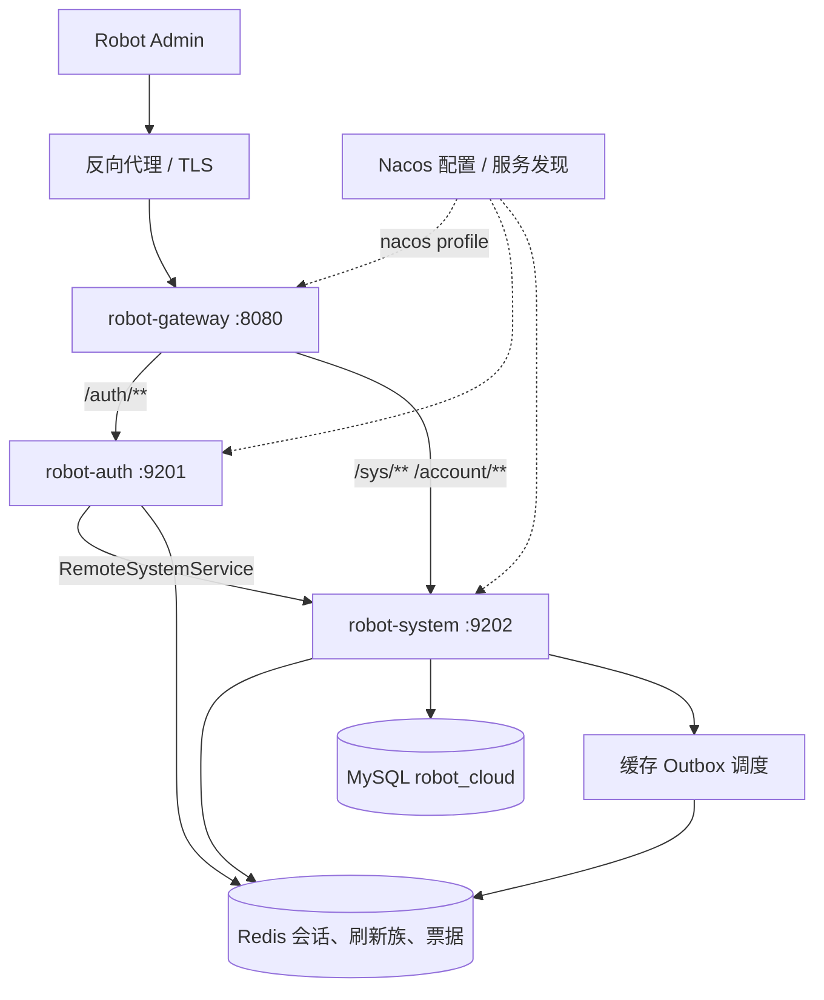
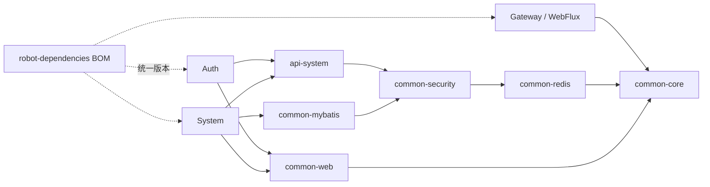
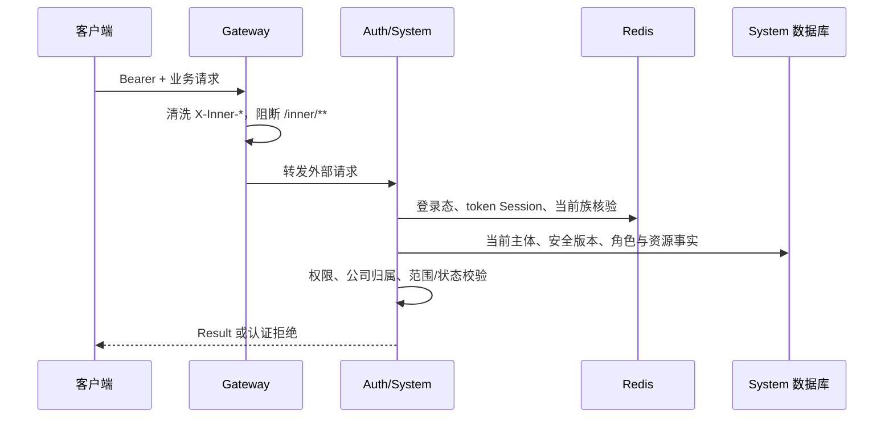
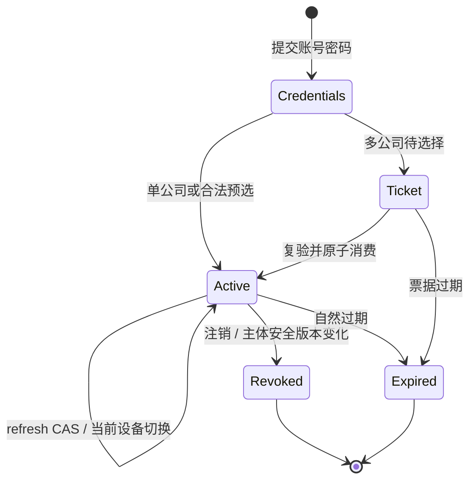
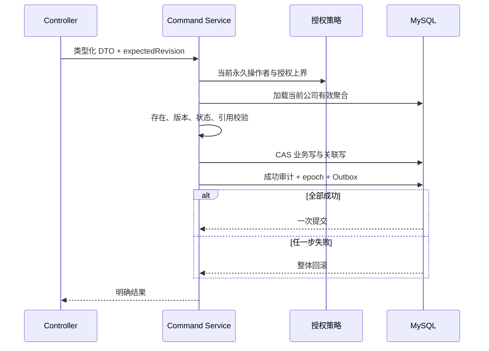
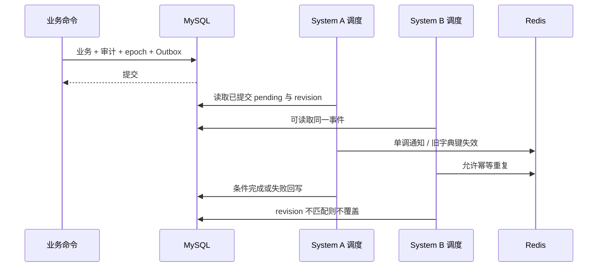
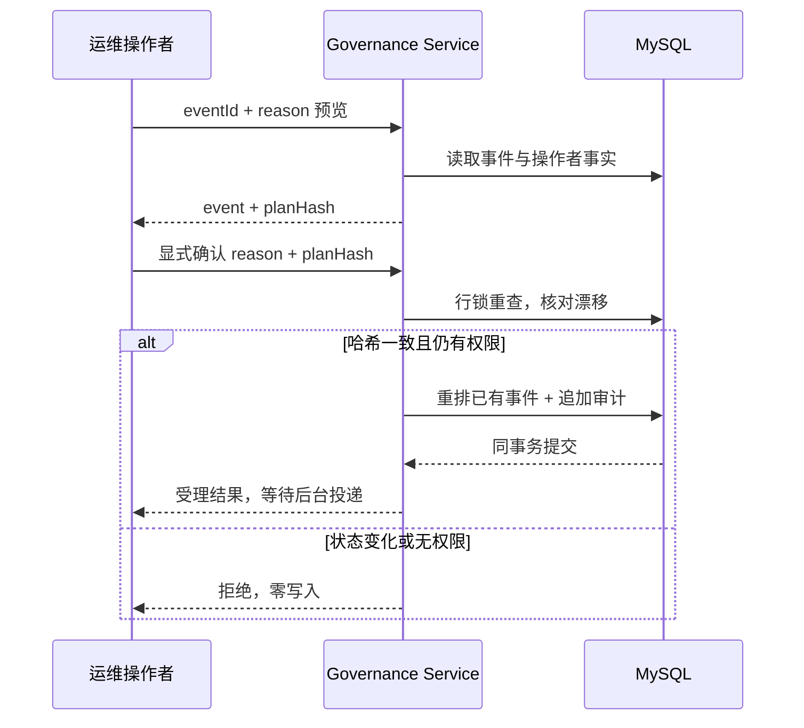
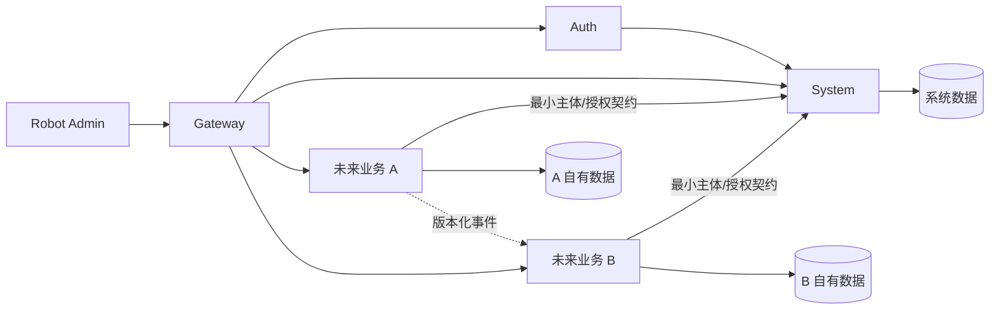

# Robot Cloud 架构与演进

本文说明当前服务、数据所有权、关键时序及未来迭代方式。面向后端开发、Robot Admin 开发和部署维护者。

当前采用 Gateway、Auth、System 三个服务。System 内保持账号、公司成员、角色及授权的本地强一致写入，通过业务分包和独立命令收敛职责。未来新增服务应具有独立业务数据和交付需求；每次拆分同时设计契约、数据迁移及故障恢复。

## 阅读地图

| 关注点 | 阅读位置 |
| --- | --- |
| 服务如何连接 | [当前服务与运行拓扑](#当前服务与运行拓扑) |
| 哪个服务负责哪些数据 | [数据所有权](#数据所有权) |
| 身份与公司如何可信传递 | [请求与信任边界](#请求与信任边界) |
| 登录、刷新和撤销 | [认证生命周期](#认证生命周期) |
| 页面版本与业务事务 | [命令与事务边界](#命令与事务边界) |
| Redis 故障后如何恢复 | [缓存一致性与恢复](#缓存一致性与恢复) |
| 如何证明交付结果 | [契约与持续门禁](#契约与持续门禁) |
| 未来如何拆服务 | [演进路线与拆分条件](#演进路线与拆分条件) |

## 当前服务与运行拓扑



| 服务 | 当前职责 | 依赖及故障含义 |
| --- | --- | --- |
| Gateway | 路由、Bearer 头检查、内部路径阻断、内部头清洗、TraceId | 无业务数据库、无会话 Redis 读取；Auth/System 不可达时请求不能成功 |
| Auth | 登录、公司选择/切换、票据、设备刷新族、注销 | Redis 保存会话，System 提供账号与成员事实；下游失败不能伪造登录成功 |
| System | 账号/成员、组织、角色、权限、菜单/按钮、字典、审计、缓存治理 | MySQL 为业务事实源；Redis 支撑请求态校验与缓存，通知失败可恢复 |

### 寻址与配置

`local` 默认关闭 Nacos config/discovery、Sentinel 和对应健康指标。Gateway 用 HTTP 直连 Auth/System；Auth 的 Feign contextId `remoteSystemService` 使用 `ROBOT_SYSTEM_URL`。此 profile 仍依赖 MySQL 和 Redis。

`nacos` 导入各服务配置，使用同一地址、namespace 和 `ROBOT_CLOUD` group。Gateway 默认 `lb://robot-auth`、`lb://robot-system`，Auth 使用服务发现。当前导入为 `optional:`，需验证配置确实加载、实例注册、真实调用和规则生效。

三服务使用同一 Redis 会话配置。自定义 key 的 `ROBOT_ENV` 不自动跟随 Spring profile，也不证明 Sa-Token 内部 key 已完成环境隔离；环境应采用明确的实例/database 隔离方案。

## 工程与依赖边界



服务间通过 API/Feign 协作，不导入对方实现 jar。common 与 API 不依赖 Auth/System 实现。Gateway 保持 WebFlux 边界，不引入 Servlet 业务组件或数据库。

| 模块 | 职责与限制 |
| --- | --- |
| common-core | 返回结构、分页、错误、断言、摘要；不放角色策略或业务状态 |
| common-web | MVC JSON、异常、TraceId；不决定公司、权限或事务 |
| common-security | token Session、族验证、内部可信上下文；业务主体事实通过明确接口核验 |
| common-mybatis | 公司插件、审计、分页、乐观锁、防全表写；不代替每条业务规则 |
| common-redis | 序列化、原子操作、缓存与锁；不作为业务授权事实源 |
| api-system | 最小跨服务 DTO 和 Feign；提供凭据的内部接口属于敏感认证供给 |
| robot-dependencies | 唯一依赖版本登记处；可选版本登记不代表能力已启用 |

### System 内部业务组织

```text
system/
├── account/          本人资料、密码与登录记录
├── user/             平台账号、当前公司成员及绑定
├── dept/             当前公司部门树
├── role/             角色查询、角色命令、临时授权命令
├── menu/             全局菜单/按钮目录与拓扑
├── dict/             字典类型、项与编码查询
├── permission/       授权事实、数据范围、授予策略、审计和缓存控制
├── security/         System 主体安全版本验证
└── api/              本服务 DTO、VO、Entity
```

Controller 绑定协议，Service 编排用例和事务，Mapper 持久化。控制设施 `PermissionStateStore` 集中管理 epoch/Outbox SQL，不向 Controller 暴露数据库访问。

角色能力拆为：

- `RoleQueryService`：分页、详情、成员视图、范围及临时授权查询。
- `RoleCommandService`：角色新增、编辑、权限重绑、删除。
- `TemporaryAuthorizationCommandService`：有界临时角色授予。
- `PermissionGrantPolicy`：唯一授予上界、自授限制和永久操作者策略。
- `EffectiveRoleResolver`：业务消费方读取有效角色事实。

职责拆分保持原聚合事务。查询类不通过写命令取数；命令不因拆成多个 Bean 而分段提交。

## 数据所有权

当前 System 拥有 `robot_cloud` schema。Auth 不直接读系统表，Gateway 不存业务数据。共享物理 MySQL 不意味着其他服务可以访问这些表。

| 数据 | 当前属主 | 关键语义 |
| --- | --- | --- |
| sys_user | System / 账号 | 全局账号、凭据摘要、当前全局部门引用、账号启用及安全版本 |
| sys_user_company | System / 成员 | 账号在公司内的成员上下文、状态、成员版本；当前表无部门字段 |
| sys_tenant / sys_company | System | 租户和公司目录 |
| sys_department | System / 组织 | 公司内部门树 |
| sys_role / sys_user_role | System / 授权 | 公司角色、成员永久绑定 |
| sys_role_menu / sys_role_button | System / 授权 | 页面与按钮分别精确绑定 |
| sys_temp_authorization | System / 授权 | 指定成员、公司、角色、半开生效时间窗 |
| sys_menu / sys_menu_button | System / 目录 | 全局导航与精确权限资源，不属于个人 Session |
| sys_dict_type / sys_dict_item | System / 字典 | 全局类型与值；当前写权限沿既有协议 |
| 登录/权限审计 | System / 审计 | 操作者、公司、对象、动作与安全元数据 |
| sys_cache_epoch | System / 缓存控制 | 权限/字典权威版本与菜单树控制行 |
| sys_cache_outbox / sys_cache_outbox_replay_log | System / 缓存控制 | 待发通知、投递围栏及重放审计 |
| access / family / ticket | Auth / Redis | 设备会话及签发状态；不是角色数据库 |

### 容易混淆的边界

“移出公司”软删当前成员并撤销该公司的关联授权，保留全局账号和其他公司的成员。跨公司共享账号的资料/密码不能由某一公司管理员任意改写；本人入口与公司独占账号规则分别承担相应职责。

`company_id` 是当前业务隔离键。全局表和关系表在插件忽略清单中并不意味着免授权：相关 Service 仍需明确归属与权限检查。

### 版本职责

| 版本 | 保护对象 | 谁提供/推进 |
| --- | --- | --- |
| user.revision | 账号资料、凭据编辑 | 详情提供；客户端提交；数据库 CAS 推进 |
| membership.revision | 当前公司成员及绑定 | 详情 membershipRevision；成员命令提交；数据库 CAS 推进 |
| security_version | 旧会话撤销 | 服务器在改密、停用、移出等安全动作推进 |
| cache epoch | 读缓存命名空间 | 业务事务推进数据库控制行；读侧读取已提交版本 |
| delivery_revision | 通知结果/重放围栏 | 完成、失败和重放的条件回写推进，阻止旧处理者覆盖新状态 |

编辑版本用于拒绝旧页面，安全版本用于拒绝旧凭据，epoch 用于拒绝旧缓存；这三种目的不能通过一个字段互相替代。

## 请求与信任边界



服务侧登录态优先；经验证的内部委托只能作为回退，不能覆盖已有登录身份。内部请求先以常量时间比较校验共享服务密钥，后绑定请求级可信上下文。部分委托、不一致的 user/company/context 必须拒绝，线程复用与异常退出需清理上下文。

`TenantQueryScope` 的登录前豁免只供已验证服务身份使用，查询仍带明确主体与公司谓词，不能把租户白名单扩大成通用绕过入口。

当前共享 bearer secret 定义同一服务信任域；它不是每个调用方的独立授权或 mTLS。新增不等信任级别的业务服务前，需要拆分认证敏感供给与普通主体供给，设计受众/服务身份、允许公司和密钥轮换，避免扩大能读取凭据摘要的调用方集合。

## 认证生命周期

公司、contextId 与账号/成员安全版本存于 token Session。同一账号的不同设备有独立刷新族，可分别处于不同公司；切换公司仅轮换当前设备。



| 状态 | 当前期限 |
| --- | --- |
| access | 1800 秒，仅头部读取 |
| family 与 refresh 摘要索引 | 7 天，轮换后重设 |
| loginTicket | 5 分钟，一次性 |

刷新先做无副作用主体复验，再准备候选 access，以单 key Redis Lua CAS 提交。竞争输家只清理自己的候选；请求验证当前族的 access 摘要，因此旧 Sa 映射清理失败也不能使旧 access 继续有效。

注销以原子消费族状态为提交点。账号/成员安全版本与密码指纹在服务侧再次核验，停用再启用不会倒退安全版本。已通过核验的在途请求不保证中途取消。

Redis 异步复制、旧快照恢复可能回退逐族注销事实；当前单节点和并发验证不能证明 HA 撤销持久性。故障分类与受控版本切换见 [认证生命周期](auth-session-lifecycle.md)。

## 公司隔离与授权

`EffectiveRoleResolver` 统一得到当前公司启用的永久绑定与生效临时角色。超管来自有效绑定；不接受 Session 快照、目录通配符或客户端声明。管理授予策略只依据永久启用角色，临时业务权限不能继续放大为永久授权。

- sys_role_menu 给予页面，sys_role_button 给予按钮，彼此不附赠。
- 祖先菜单用于导航完整性，不自动获得页面权限。
- 资源匹配要求公司、启用、有效删除标记和真实 ID；普通权限仅接受精确码。
- 自编辑、自绑定、超授与跨公司资源按策略拒绝。
- 用户列表/详情在 SQL 中消费 self/department/department_below/all 范围；非法部门链退回本人，无有效范围拒绝。

该范围实现针对当前用户资源，并非所有未来业务表的通用数据权限引擎。新增业务需明确自己的资源、部门关系、写范围、字段策略和负向测试。

## 命令与事务边界

### 页面版本合同

| 命令 | 页面提交 | 保护范围 |
| --- | --- | --- |
| 用户移出 | query expectedRevision = membershipRevision | 当前公司成员及授权关系 |
| 用户启停 | status + expectedRevision = membershipRevision | 当前成员状态及撤销版本 |
| 重置密码 | password + expectedRevision + expectedMembershipRevision | 账号凭据与当前管理成员关系 |
| 角色删除 | query expectedRevision = role.revision | 角色及关联资源 |
| 角色/权限编辑 | revision | 角色及菜单/按钮绑定 |
| 完整成员编辑 | membershipRevision；涉及账号另有 revision | 成员与必要账号资料 |

先核对页面版本，持久化仍限定有效对象、公司、状态及版本，影响行数不符合预期时拒绝。仅使用锁后数据库最新 revision 不能保护旧页面意图。

### 聚合原子性



重置密码同时保护账号和成员关系；成员 CAS 作为管理授权关系的版本栅栏，账号 CAS 推进凭据安全版本。成功后客户端刷新两类编辑版本。

菜单树更改先锁 menu-tree 控制行，字典聚合锁定类型。这些锁保护跨行不变量，仍不能代替要求客户端版本的页面合同。

远程 HTTP/Feign、文件和通知不进入本地业务事务。新增需要远程资料的命令可先预取，由独立 Bean 开始短事务重新读取/锁定本地依据；远程资料变化的一致性约定也需明确，不能把本地重校验误认为跨服务锁。

## 缓存一致性与恢复

### 权威事实与投递



数据库 epoch 进入缓存键，Redis 通知不是事实源。权限结果的 TTL 不能跨下一临时授权边界；字典值使用数据库版本命名空间，旧通知只清理旧键。Redis 清空、通知乱序或旧载荷回填不能改变数据库已提交 epoch，也不能让新请求复用旧权限命名空间。

权限通知 key 保留7天；当前单调 Lua 保护已存在 key 的版本。跨 TTL 过期后重放历史通知可能重新建立较旧的提示数字，读侧仍以数据库 epoch 为准。故障验收证明本轮有效 key 生命周期内的通知单调性，不将其扩展为跨过期、HA 或任意状态回退保证。

当前缓存通知允许多实例重复执行幂等 Redis 操作。它不承诺发送 exactly-once，也不能直接复用为有非幂等外部副作用的业务消息投递器。

### 故障与恢复语义

| 故障 | 当前结果/恢复要求 |
| --- | --- |
| 业务/审计/入队失败 | 整个业务事务回滚，epoch 不推进 |
| 数据库提交后 Redis 不可达 | 事件持久 pending，通知按退避重试 |
| Redis 执行成功但确认丢失 | 可重复通知；版本单调与幂等失效保持正确 |
| 多 worker 重复或迟到回写 | delivery_revision 条件保护，旧结果不能覆盖新结果或重放 |
| 服务重启 | 重新扫描已提交事件，不能只依赖进程内事件 |
| Redis 旧快照/HA 回退 | 缓存版本重新取数据库；会话族恢复风险单独验收 |

Redis 故障时保护请求可能无法完成身份验证；“通知可恢复”不表示整个系统仍能处理全部登录/业务请求。

### 重放治理

`/sys/cache-outbox` 要求专属 `sys:cache-outbox:manage`，Service 再检查当前永久超级管理员事实。查询有界，不输出 Redis key 或下游错误原文。



重放不修改 epoch/cacheVersion，不构造任意 Redis 目标。理由为受控枚举，成功仅证明重新排队与审计提交。

### 可观测性

使用 pending、due、failed、retries、maxAttempts、oldest age、snapshot age 与投递结果/时延指标。标签仅使用固定结果和错误类别，不使用用户、公司、eventId 或 cacheKey，避免高基数和身份泄露。

采集线程刷新数据库快照；Prometheus scrape 读取内存快照，不依赖实时数据库连接。数据库不可达时保留最近快照，并通过 snapshot age 暴露过期。告警应结合最老年龄与流量基线，不把 pending 短时增长等同于故障。

缓存通知错误只存受控类别和 failureId，不存任意 ex.getMessage、响应体、凭据或敏感 URL。共享异常处理器日志只记录固定类别、业务码和 traceId，技术响应固定；业务校验消息需保持面向用户且不含敏感值。网关和 Servlet 统一约束 TraceId 格式及长度，框架 DEBUG/TRACE 请求载荷日志由部署控制。完成记录保留期/归档需运维定稿；pending 不能按普通 TTL 清理。

## 契约与持续门禁

入口为 `scripts/verify.sh`；`--mysql-upgrade` 显式增加隔离真实数据库检查。CI 运行相同入口，保留 XML、失败记录和制品哈希。

| 门 | 重点与范围 |
| --- | --- |
| 编译/行为/ArchUnit | 实际 Service、MVC、JSON、事务和依赖方向 |
| 用户/角色机器合同 | HandlerMapping、权限、请求约束、视图和治理字段 |
| 迁移 manifest | 真实 SQL 版本、顺序、字节哈希和历史不可变 |
| 打包 Mapper | 从最终 Boot JAR 取生产类/依赖，组装 Mapper 和 statement；H2 仅为离线探针驱动 |
| 已有库升级 | 隔离 V5 数据与历史升级到当前迁移，检查保全、结构、唯一约束、重复历史软删与拒绝无历史接管 |
| 运行故障验收 | 两 System、真实 MySQL/Redis、连接故障、丢确认、重复/迟到与重启 |
| 生产出口 | 目标环境、Admin、Nacos/Sentinel、容量、HA及恢复演练 |

用户/角色数据库合同当前是明确子集，不能推导全库字段语义或结构已经被机器治理。新增表/命令必须扩展相应合同与验收。

Maven、源码测试存在、制品绑定、真实单节点、多实例、生产验收分别记录。仓库已配置 GitHub/Gitee 双远程，`main` 为稳定主分支、`dev` 为集成基线；远端 CI 实际结果以对应提交的 Actions 记录为准，本地运行相同入口不替代托管验证。协作与同步流程见 [Git 维护流程](git-workflow.md)。

## 演进路线与拆分条件

### 阶段一 当前底座

目标是稳定 Gateway/Auth/System：写命令闭环、契约和 CI、数据库升级、可恢复通知及清晰运行文档。

账号、成员、角色、资源绑定、权限审计和 epoch 保持同库事务。先用单服务内业务包和查询/命令边界控制复杂度，再根据真实业务变化评估进程拆分。

### 阶段二 独立业务服务

出现订单、资产、工单等独立产品能力时，按实际数据所有权新增服务。下图是演进示意，不是当前已存在模块：



每个业务服务拥有自己的写模型和迁移，可先同一物理数据库实例、独立 schema/账号。跨服务不直接读写系统表，不建立跨服务数据库外键，不共享可写 Entity jar。

普通主体供给与敏感认证供给需要不同受众。业务服务自行落实资源归属、数据范围与命令权限；只拿到权限数组或“已登录”不能替代领域内检查。

### 阶段三 有需求后提取共享运行能力

| 候选 | 拆分触发条件 | 必须保留/补齐 |
| --- | --- | --- |
| 审计查询/归档 | 大量历史查询、独立留存或检索需求 | 源服务成功审计先持久化，投影可重放、可去重 |
| 文件/导出/异步任务 | 独立资源消耗、任务生命周期或扩容需求 | 数据范围、任务属主、幂等、状态、大小限制和恢复 |
| 通知/外部适配 | 多个真实业务消费者、独立协议和交付需求 | 稳定事件ID、真实transport、Inbox/Outbox、重试/死信 |
| 身份与授权进一步分离 | 团队/部署边界独立且强一致成本可承受 | 账号/成员撤销传播、权限版本、延迟与失败关闭策略 |
| 字典/参考数据 | 多产品独立维护与发布需求 | 单一事实源、版本、兼容及缓存失效 |

### 每次拆分的准入条件

1. **业务属主**：明确能力、数据和维护责任；存在独立发布/容量/故障隔离需求。
2. **契约**：API/事件版本、错误、超时、受众、幂等键、顺序与兼容窗口明确。
3. **一致性**：保留本地事务；跨服务采用可靠事件/补偿，接受其明确的延迟与失败语义。
4. **迁移**：Expand → 回填/对账 → 切读写 → 观察 → Contract；只有一个权威写入方。
5. **运行**：可观测、可独立部署、探针、容量、恢复和告警有证据。
6. **切换**：灰度范围、停止条件、恢复路径和新旧客户端协议被验收。


避免不可控双写。若需要双读或影子读，用对账确认语义；跨服务引用记录稳定 ID，展示投影不能越权成为主数据写入口。拆分后失败关闭可能降低可用性，应以实际 SLO、链路延迟和恢复预算评估，不默认引入 Seata 或消息中间件解决所有问题。

## 当前设计决策

| 决策 | 原因 | 重新评估条件 |
| --- | --- | --- |
| 三个运行服务，System 内模块化 | 当前系统管理写入关联紧密，便于维护完整事务 | 形成独立业务属主/发布/容量需求 |
| 不透明 access + Redis 刷新族 | 当前设备独立上下文与撤销模型 | Redis/主体 RPC 延迟和 HA 保障方案有证据 |
| DB epoch + 缓存 Outbox | 缓存删除失败不能恢复旧授权 | 读成本显著时评估版本快照，但保留撤权语义 |
| 缓存通知允许重复 | 操作为单调版本推进和幂等旧键删除 | 新外部副作用需另设计业务事件投递 |
| MyBatis-Plus 当前无自定义 XML | 简化当前系统查询/命令 | 复杂 SQL 出现时增加资源与 statement 检查 |
| Flyway 默认不自动 baseline | 防止未评审接管非空库 | 仅经过明确基线评审的迁移窗口 |
| 共享内部密钥 | 当前受控内网的实现边界 | 新服务信任级别不同、需轮换/受众隔离 |
| 保留现有 BOM 基线 | 版本变化需联合回归 | 安全/支持要求或功能需要时评估升级 |

## 交付和后续验证

交付绑定当前源码与制品SHA，仓库内摘要见 [本轮验收](verification-2026-10-09.md)。[原始执行回执](../../../output/robot-cloud-iteration-2026-10-09/evidence.json)位于开发工作区，独立clone不自带，托管CI另以artifact留存。以下项目必须独立留证：目标生产数据库版本、真实 Admin 页面、Nacos/Sentinel、Redis HA 回退、容量与备份恢复。

本地隔离故障演练针对数据库版本及缓存通知；不能由此推导 HA 会话注销持久性、所有未来业务范围或跨服务事件平台已验证。

接口、授权和运行细节分别见 [API](api-contract.md)、[系统权限](system-permission-contract.md)、[认证生命周期](auth-session-lifecycle.md)、[缓存与字典](cache-and-dictionary-contract.md)和 [部署](deployment.md)。
