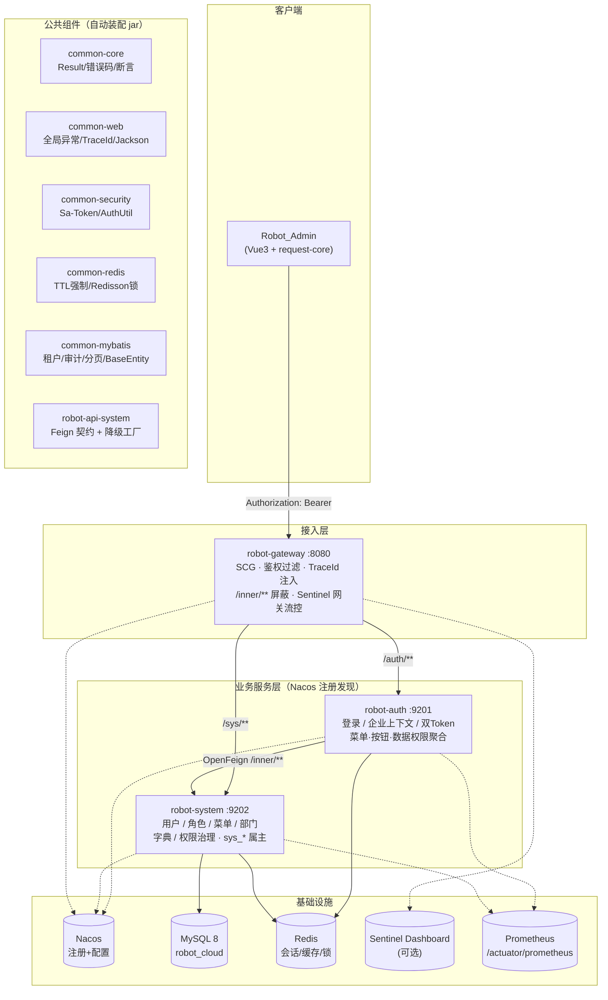
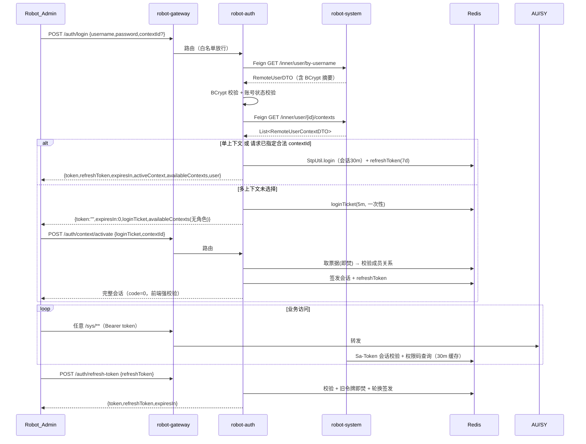

# Robot Cloud 架构设计

> 版本：1.0.0 · 日期：2026-10 · 面向：Robot_Admin 中后台前端
> 规范基线：Spring Cloud Alibaba 官方最佳实践 + wl-skills-bd（B1~B32 / standards 01~30）通用要求

---

## 1. 架构总览

### 1.1 全景图



### 1.2 模块职责与依赖方向

```text
robot-dependencies（BOM，版本唯一登记）
        ↑ parent
robot-cloud（聚合根）
 ├── robot-common-core        ← 无框架依赖（jackson-annotations + slf4j + hutool）
 ├── robot-common-web         ← core + spring-boot-starter-web/validation
 ├── robot-common-security    ← core + sa-token(+redis)
 ├── robot-common-redis       ← core + spring-data-redis + redisson
 ├── robot-common-mybatis     ← core + security(AuthUtil) + mybatis-plus
 ├── robot-api-system         ← core + openfeign（无实现依赖，可被任何服务引用）
 ├── robot-gateway            ← core + SCG(webflux) + nacos + sentinel
 ├── robot-auth               ← web/security/redis/api-system + nacos/sentinel/feign/bcrypt
 └── robot-system             ← web/security/mybatis/redis + mysql/flyway + knife4j
```

依赖铁律：

- **单向依赖**：common 之间只允许 `core → (web|security|redis|mybatis)`，业务服务依赖 common + api 契约，禁止服务之间直接依赖实现 jar。
- **网关零业务**：gateway 只依赖 common-core，不连业务库、不做业务判断。
- **契约先行**：跨服务 DTO 一律放 `robot-api-system`（对齐 wl-skills-bd「wl-apis」目录角色），Feign 接口与降级工厂同模块交付。
- **内部调用鉴权**：`/inner/**` 三重防护——网关路由不暴露 + 网关清洗伪造 `X-Inner-Call` 头 + 服务侧 `InnerCallInterceptor` 校验共享密钥（`ROBOT_INNER_SECRET`）；Feign 侧由 `InnerCallRelayInterceptor` 自动携带。

---

## 2. 请求链路

### 2.1 一次外部请求的完整路径

```text
Robot_Admin
  │  Authorization: Bearer <token>
  ▼
robot-gateway :8080
  ① AuthGlobalFilter(order=-100)
     ├─ TraceId：沿用/生成 X-Trace-Id → 透传下游 + 响应头回传
     ├─ /inner/** 屏蔽：外部访问一律 403
     ├─ 清洗客户端伪造的 X-Inner-Call 头（单次 mutate 原子化）
     └─ 白名单放行：/auth/login、/auth/login-companies、/auth/refresh-token、
        /auth/context/activate（loginTicket 激活发生在拿 Token 之前）、actuator
  ② Sentinel 网关流控（gw-flow 规则可由 Nacos 推送）→ 超限 429 + 统一 Result
  ③ 路由谓词 Path=/auth/**|/sys/** → lb://robot-auth|robot-system
  ▼
业务服务（robot-auth / robot-system）
  ④ TraceIdFilter：MDC 写入 traceId（日志模板 %X{traceId}），请求结束清理
  ⑤ Sa-Token SaInterceptor：注解鉴权(@SaCheckPermission)；白名单由 robot.security.exclude-paths
  ⑥ Controller → Service（业务规则/事务边界）→ Mapper（MP 插件链）
     插件链顺序（固定）：租户 → 分页(maxLimit 500) → 乐观锁 → 防全表写
  ⑦ 异常：ServiceException → GlobalExceptionHandler → Result(code/message/msg/traceId)
     401/403 由 security 模块 advice 映射 HTTP 状态码
```

### 2.2 认证时序（登录 → 激活 → 访问 → 刷新）



### 2.3 登录态与双 Token 设计

| 凭据 | 存储 | TTL | 语义 |
|---|---|---|---|
| 访问令牌 token | Sa-Token 会话（Redis `satoken:login:token:*`） | 30 分钟 | 每请求 `Authorization: Bearer` 校验；网关与服务共享 Redis 统一校验 |
| 刷新令牌 refreshToken | `robot:{env}:auth:refresh-token:{rt}` | 7 天 | **一次性轮换**：刷新即作废旧令牌，防重放；值 `{userId}:{contextId}` |
| 登录票据 loginTicket | `robot:{env}:auth:login-ticket:{t}` | 5 分钟 | 凭据已验、待选公司；**激活即焚**，单次有效 |

安全规则（对齐 standards/11 与前端契约注释）：

- 角色只由认证服务在**激活后**授予，客户端提交的角色/公司字段一律不信任；
- 登录失败统一「账号或密码错误」话术（防账号枚举）；`login-companies` 对未知/停用账号返回空清单；
- 网关只做 Token 存在性与白名单校验，真实有效性由服务侧会话校验完成（网关无业务库依赖）。

---

## 3. 多租户与数据隔离

### 3.1 模型：租户 → 公司 → 用户

```text
sys_tenant（平台）
   └── sys_company（COMPANY_ID = 数据隔离键）
          ├── sys_user_company（成员关系，ID 即前端 contextId，primary_flag 唯一主公司）
          ├── sys_department / sys_role（租户表，自动过滤）
          └── 业务数据表（均含 COMPANY_ID）
sys_user（全局：登录跨公司）
sys_menu / sys_menu_button / sys_role_menu（全局：菜单权限按角色过滤）
sys_dict_type / sys_dict_item（全局）
```

### 3.2 行级过滤机制（bd「统一拦截器证据」）

`RobotTenantLineHandler` 实现 MP `TenantLineHandler`：

- 租户值**唯一来源** `AuthUtil.getLoginCompanyId()`（登录会话），未登录返回 `NULL` 字面量 → `company_id = NULL` 恒假 → **宁可查空，不可泄露**；
- 全局表白名单（`robot.mybatis.tenant.ignore-tables`）：`sys_tenant/company/user/user_company/menu/role_menu/menu_button/dict_type/dict_item`；新增全局表必须显式登记并评审；
- INSERT 路径：`AuditMetaObjectHandler` 自动填充 `company_id`（`strictInsertFill`，显式赋值优先，支持数据修复场景）。

### 3.3 审计八列（ID + 七治理字段）

所有业务表继承 `BaseEntity`：

| 列 | 填充时机 | 说明 |
|---|---|---|
| `ID` | INSERT（RobotIdGenerator） | String 32+5 位不透明 ID，VARCHAR(64) |
| `COMPANY_ID` | INSERT | 登录态公司 |
| `CREATE_USER_NO` / `CREATE_DATE_TIME` | INSERT | 登录名（系统任务=SYSTEM）/ 服务器时间 |
| `UPDATE_USER_NO` / `UPDATE_DATE_TIME` | INSERT + UPDATE | |
| `DELETE_FLAG` | INSERT=1 | 1=有效 0=删除；MP 逻辑删除全局启用（`removeById` 软删） |
| `REVISION` | INSERT=0 | `@Version` 乐观锁；并发冲突由全局映射返回 40902 |

实体基类拆分：全局表（无 COMPANY_ID）继承 `BaseEntity`；租户表继承 `TenantEntity`（多 company_id 隔离键字段）。框架级异常语义：唯一键冲突 → 40901 DATA_DUPLICATED、乐观锁冲突 → 40902（GlobalExceptionHandler 统一映射，业务代码无需逐个捕获）。

---

## 4. 关键数据流

### 4.1 动态菜单（/auth/menu-list）

```text
登录会话(userId, companyId)
  → robot-auth Feign /inner/menu/{companyId}/routes
  → MenuService.routesOfUser
      ├─ 全局菜单 activeMenus()（status=1）
      ├─ grantedMenuIds(userId, companyId)
      │    ├─ 超管(SUPER_ADMIN) → null（不过滤）
      │    └─ 否则 本公司角色 ∩ sys_user_role → sys_role_menu → menuIds
      └─ toRoutes() 组树 → RemoteMenuRouteDTO{path,name,component,redirect,meta,children}
```

菜单表是前端动态路由**唯一数据源**（对齐 Robot_Admin 约定）：新增页面 = 前端注册组件 + 本库新增菜单记录。

### 4.2 权限码体系

```text
页面码：sys_menu.perm_code      如 sys:user:list
按钮码：sys_menu_button.perm_code 如 sys:user:save
        ↓
RobotStpInterface.getPermissionList（30m Redis 缓存，角色/菜单变更 evict）
        ↓
@SaCheckPermission("sys:user:save") 注解校验；超管返回 "*" 直通
        ↓
/auth/button-list 返回 { 菜单path: [权限码...] } 供前端 v-permission 指令
```

### 4.3 数据权限（/auth/data-permission）

角色 `DATA_SCOPE`（all/custom/department_below/department/self）+ **生效中的临时授权**（30 天上限）聚合，多角色取最强范围，输出前端 `GetDataPermissionResponse` 契约；部门级裁剪在业务查询中由 Service 按 scope 附加部门过滤（骨架已留位，逐业务落地）。

### 4.4 字典缓存

`sys_dict_type/item`（全局表）→ `RedisHelper.getOrLoad`：30 分钟 TTL + 抖动；miss 回源 DB；不存在写 2 分钟空值占位（防穿透）；写操作后 `evict`。Key：`robot:{env}:system:dict:{typeCode}`。

### 4.5 权限缓存版本化失效

权限码缓存键携带版本段 `robot:{env}:system:permissions:{co}:{uid}:v{version}`；角色/菜单/按钮/临时授权任一变更自增 `robot:{env}:system:perm-version`（7 天 TTL，等价持久键已按 standards/20 登记说明），实现全量**惰性失效**——无需枚举用户逐个清除。超管判断使用新鲜 DB 角色而非会话快照，撤销即时生效。

### 4.6 登录日志

认证服务在 login/activate/switch/refresh/logout 时经 `/inner/log/login-record` 打点（尽力而为：失败静默，不影响认证主流程）；`sys_login_log` 落库（IP/UA/类型/结果），供 `/account/login-records` 与安全审计使用。

---

## 5. 服务间协作

### 5.1 OpenFeign 约束（standards/22）

- 契约集中在 `robot-api-system`：`RemoteSystemService` + DTO + `RemoteSystemServiceFallbackFactory`（降级返回统一失败码并记录日志，禁止异常裸穿）；
- 显式超时：connect 3s / read 8s；**默认不自动重试**（登录链路重试会放大凭据尝试）；幂等查询可在 client 级单独开 `Retryer`；
- `/inner/**` 只读为主；跨服务写走最终一致（见 tech-selection §Seata/RocketMQ 演进）。

### 5.2 网关路由表

| 路由 | 谓词 | 目标 | 备注 |
|---|---|---|---|
| robot-auth | `Path=/auth/**` | `lb://robot-auth` | 请求体上限 5MB |
| robot-system | `Path=/sys/**` | `lb://robot-system` | 请求体上限 10MB |

外网不可达：`/inner/**`（网关 403）；`httpclient` 连接 3s / 响应 15s 超时。

---

## 6. 横切关注点

### 6.1 可观测性

| 维度 | 实现 |
|---|---|
| 链路 | 网关生成/透传 `X-Trace-Id` → 服务 MDC → 日志与异常响应回带 |
| 指标 | actuator + micrometer-prometheus（`/actuator/prometheus`，网关另暴露 gateway metrics） |
| 日志 | 统一 pattern `%d %level [traceId] [thread] %logger - %msg`；error 级异常必须带堆栈，warn 级业务失败不刷屏 |
| API 文档 | Knife4j（OpenAPI 3）：`/doc.html`（生产环境经网关屏蔽，见 deployment） |

### 6.2 弹性与稳定性（Sentinel）

| 层 | 策略 |
|---|---|
| 网关 | gw-flow 规则（Nacos 数据源 `robot-gateway-flow-rules`，group `SENTINEL_GATEWAY_GROUP`）；限流响应统一 `Result{code:429}` |
| 服务 | `@SentinelResource` 按需声明（热点接口）；Feign 降级工厂兜底 |
| 数据库 | 分页 maxLimit=500；BlockAttack 禁全表 update/delete；saveBatch ≤ 1000 |

### 6.3 配置分层（standards/24/25）

```text
优先级：本地 application-{profile}.yml < Nacos robot-{service}.yml(ROBOT_CLOUD) < 环境变量
本地 profile=local：nacos discovery 关闭，脱离注册中心可独立启动（联调友好）
dev/test/prod：SPRING_PROFILES_ACTIVE=nacos + NACOS_SERVER_ADDR，配置中心接管
密钥：只允许环境变量/Nacos 加密配置，禁止入库入码（.gitignore 拦截 *.local.yml/.env）
```

### 6.4 数据安全护栏（B13~B23 落点）

| 护栏 | 工程落点 |
|---|---|
| Redis 写必带 TTL | `RedisHelper` 无 TTL API 不存在；持久 Key 需登记白名单 |
| 锁唯一 Redisson | `LockTemplate`（tryLock+watchdog+`isHeldByCurrentThread` 安全释放） |
| 禁 KEYS */FLUSH* | 代码零直接 template 裸用；删除走 `unlink` |
| 物理删禁令 | MP 逻辑删除全局启用；DDL 无 DROP 语句（expand-only 迁移） |
| 全表写禁令 | BlockAttackInnerInterceptor |
| 批量上限 | `BATCH_WRITE_LIMIT=1000` 常量 + Service 校验 |
| 事务内禁 MQ/HTTP | 编码规约 + 评审（本期无 MQ 依赖，天然满足） |
| 敏感写二次确认 | 临时授权强制 reason + 30 天上限 + 审计日志 |
| Flyway 不可变 | 已发布 migration 只增不改；DDL 只生成不手工执行 |

---

## 7. 部署拓扑（详见 docs/deployment.md）

```text
                    ┌───────────── Nginx/SLB ─────────────┐
                    │        robot-admin 静态资源           │
                    └──────────────┬───────────────────────┘
                                   │ /api 反代
                     ┌─────────────▼──────────────┐
                     │  robot-gateway ×2 (无状态)  │
                     └──────┬──────────────┬──────┘
                            │              │
                  ┌─────────▼───┐   ┌──────▼────────┐
                  │ robot-auth  │   │ robot-system  │     ── 各 ×2，Nacos 注册
                  └──────┬──────┘   └──────┬────────┘
                         └───────┬─────────┘
                    ┌────────────▼─────────────┐
                    │ MySQL 主从 · Redis 哨兵/集群 │
                    └──────────────────────────┘
```

容量假设（初始）：网关 2C4G×2，服务 2C4G×2 each，MySQL 4C8G 主从，Redis 1G。SLO 建议：网关 P99 < 200ms（不含下游），登录链路 P99 < 800ms，可用性 99.9%（详见 deployment §监控告警）。

---

### 7.1 服务内部颗粒度（读写分离与会话收敛）

| 组件 | 职责 |
|---|---|
| `MenuQueryService` / `MenuService` | 菜单读侧（树/路由/权限装配，无事务）与写侧（CRUD/拖拽，事务边界）分离 |
| `AuthSessionManager` | 会话副作用收敛：Sa-Token 登录、双 Token 签发/轮换/注销、登录打点；AuthService 只做流程编排 |
| `PermissionChangeRecorder` | 权限类变更唯一入口：审计留痕 + 缓存版本失效一次完成（15 类动作全覆盖） |
| record VO | 全部 REST 出参类型化（MenuTreeNode/DictNode/DepartmentNode/RoleOptionVO/DataScopeVO/AccountProfileVO 等 14 个 record），消除 Map 出参 |

## 8. 演进路线（预埋接口，不在本期）

| 能力 | 预留 |
|---|---|
| Seata AT 分布式事务 | BOM 已登记 2.2.0；出现跨服务写场景后按 `docs/tech-selection.md §9` 启用 |
| RocketMQ 事件驱动 | BOM 已登记 starter；跨服务写改事件最终一致时启用 |
| 多数据源 | dynamic-datasource 版本已登记；单库优先，按业务中心拆库演进 |
| SkyWalking 全链路 | traceId 已贯通，接入 Agent 即可补齐 span 级追踪 |
| 业务中心扩展 | 新服务复制 robot-system 结构（子域优先包 + api 契约模块 + Flyway）即可，端口分配见 deployment §端口规划 |
