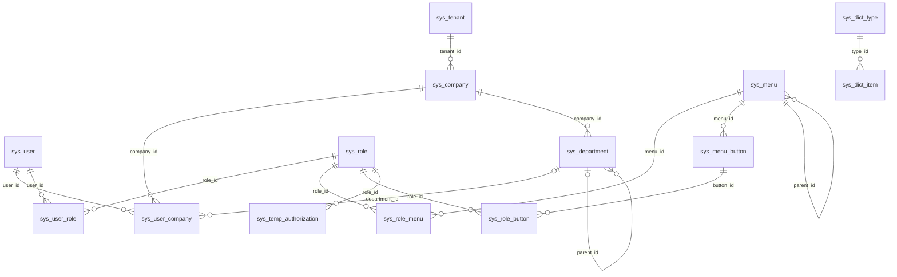

# 数据库设计（MySQL 8 · robot_cloud）

结构事实源为 `robot-services/robot-system/src/main/resources/db/migration/`。已发布 V1–V10 保持字节不可变，本轮既有 V1–V12 同样冻结；当前只追加 V13，共 20 张表。V13 仅变更导航数据，不改变 V12 的列、生成列或索引。完整结构属性及迁移哈希的固定机器合同见 [full-schema.json](../contracts/database/full-schema.json)，运行验收状态见 [部署文档](deployment.md)。

## 治理与控制表

业务实体主键为VARCHAR(64)的不透明String。全局实体BaseEntity包含id、创建/更新人和时间、delete_flag、revision；TenantEntity另含company_id。CompanyId只取服务端身份，关系表的company_id仍需显式业务边界，不能因为在租户忽略清单内就省略授权。

| 列 | 当前类型与规则 |
| --- | --- |
| id | VARCHAR(64)，应用生成；不可把不可预测ID当作授权防线 |
| company_id | VARCHAR(64)，公司隔离键；全局表可无此列，成员关系保留关联公司列 |
| create_user_no/create_date_time | VARCHAR(64)/DATETIME，插入填充，更新保持 |
| update_user_no/update_date_time | VARCHAR(64)/DATETIME，插入与每次更新填当前操作者/时间 |
| delete_flag | TINYINT，默认1；1有效、0软删 |
| revision | INT默认0；编辑比较客户端版本，实际影响行数为0即冲突 |
| security_version | sys_user与sys_user_company的BIGINT默认0；会话撤销用，不由普通资料编辑版本替代 |

`sys_cache_epoch`、`sys_cache_outbox`是系统控制表，不继承业务治理实体。epoch 是数据库权威版本；outbox 可以更新投递状态，与只追加的权限审计分工不同。`sys_permission_audit_log`仅经业务追加。认证服务的登录事件通过可恢复队列投递，System 持久化成功才确认，`event_id`唯一键保证重复投递仅追加一次。

## 表与主要索引（迁移后）

| 表 | 隔离与用途 | 主要列/约束 |
| --- | --- | --- |
| sys_tenant | 全局租户 | tenant_name唯一，status_flag |
| sys_company | 全局公司 | tenant_id索引，status_flag；公司ID是隔离键 |
| sys_user | 全局平台账号 | username、BCrypt password_hash、全局昵称/邮箱/电话、status_flag、security_version；活跃username唯一；独立platform_admin_flag默认0；旧department_id只供升级对账 |
| sys_user_company | 全局关系表 | user_id/company_id/contextId、成员department_id、status_flag、primary_flag、security_version；活跃(company,user)唯一，每用户至多一个未删除primary |
| sys_department | 公司部门树 | company_id、parent_id、status_flag；索引(company,parent) |
| sys_role | 公司角色 | role_code/data_scope/status_flag；活跃(company,role_code)唯一 |
| sys_user_role | 公司角色绑定 | user_id、role_id；活跃(company,user,role)唯一 |
| sys_menu | 全局菜单 | parent_id、menu_type、path、component、perm_code、sort_no、visible_flag/keep_alive_flag/status_flag、remark；父级排序索引 |
| sys_menu_button | 全局按钮目录 | menu_id、perm_code、sort_no、status_flag、remark；菜单索引；精确权限码业务校验 |
| sys_role_menu | 全局关系表 | 活跃(role,menu)唯一；不自动附赠按钮 |
| sys_role_button | 全局关系表（V5） | 活跃(role,button)唯一；精确按钮授权 |
| sys_dict_type | 全局字典类型 | type_code/type_name/status_flag/remark；活跃type_code唯一 |
| sys_dict_item | 全局字典项 | type_id/item_code/item_label/item_value/status_flag/sort_no/remark；同类型活跃code、value分别唯一 |
| sys_temp_authorization | 公司临时角色授权 | user_id/role_id/effect_from/effect_to/reason/status_flag；当前实现半开时间窗和30天上限 |
| sys_permission_constraint | 公司约束配置 | rule_name/rule_type/config_json/status_flag；目前供读取，没有通用规则执行器 |
| sys_permission_audit_log | 公司权限审计 | actor_user_no/action/target/detail；公司、有效标记、时间与ID历史索引；只追加 |
| sys_login_log | 公司登录日志（V3/V11） | user_id/username/login_type/status_flag/ip/user_agent/login_time；用户/公司时间索引；可空event_id UUID唯一 |
| sys_cache_epoch | system控制表（V6） | scope主键、version BIGINT；permissions和menu-tree初始化为1；字典按编码建版本；company-write:公司ID作为聚合协调锁行；authorization-time-utc-v1登记保护环境已确认的UTC解释合同 |
| sys_cache_outbox | system控制表（V6/V10/V12） | 事件kind/key/version、delivery_revision、next_attempt_at、completed_at、attempts、quarantined_at、archived_at；到期/近期/留存索引 |
| sys_cache_outbox_replay_log | 追加运维审计（V10） | event_id、actor_user_id、actor_company_id、受控reason、previous_revision/new_revision、created_at；索引(event_id,created_at) |

V10 为 outbox 增加 `delivery_revision BIGINT NOT NULL DEFAULT 0` 和 `last_failure_id VARCHAR(36)`。围栏版本用于投递确认、失败重排和人工重放的条件更新；与权限 epoch、通知携带版本、实体编辑版本职责不同。失败只保存允许的类别和随机关联 ID，不落原始异常消息或 payload。

V11 为每个公司成员增加一个 `department_id`。回填只采纳未删除账号的旧部门，且部门必须属于该成员公司、启用且未删除；跨公司、失效和空的旧部门不会复制。旧 `sys_user.department_id`保留供对账，新写入、用户读侧范围、自助资料和登录上下文均以成员主部门为准。

当前公司管理员移出或停用的是 `sys_user_company`，保留平台账号与其他公司成员。昵称、邮箱、电话、密码仍在 `sys_user`。公司管理 API 只修改本公司独占账号的全局资料/密码；共享账号由本人受控入口更新。独立平台管理员目前没有额外的全局账号重置 API。资料省略字段保留原值，邮件/电话或成员部门显式 null 可以清空；昵称不能清空。

`platform_admin_flag`是独立全局账号事实，默认 0，公司 `SUPER_ADMIN`不会自动获得此标记。普通用户请求 DTO 不开放该字段。首次交接仅经显式可信 bootstrap 指定既有有效账号完成，并同事务更新账号安全版本、追加审计、递增 epoch、写入 outbox；配置完成声明不能代替生产启动时对实际交接事实的检查。

图为应用关系，不表示DDL已经定义外键。代码和唯一索引共同保护关联；存量孤儿及跨公司绑定须在迁移前审查。

## 迁移与软删唯一性

| 迁移 | 变更 |
| --- | --- |
| V1–V5 | 初始化、种子、登录日志、按钮目录扩展和独立role_button |
| V6 | 持久epoch/outbox与菜单树锁行 |
| V7 | 账号/成员security_version，菜单/按钮remark；username和role_button改为仅未删除记录唯一 |
| V8 | 字典类型status、项独立code与remark；存量item_code由item_value回填；活跃字典code/value唯一 |
| V9 | 活跃角色码、成员、唯一primary、user_role、role_menu唯一 |
| V10 | 通知投递围栏、安全故障关联ID、追加重放审计；登记仅永久超管治理的精确按钮权限 |
| V11 | 独立平台管理员事实、成员主部门合法回填与索引、登录投递UUID幂等键 |
| V12 | Outbox永久非法事件隔离、完成历史逻辑归档、到期/留存索引及临授/审计分页索引 |
| V13 | 权限治理导航种子及已有角色列表导航的入口继承；纯 DML，20 表结构属性不变 |

V7–V9使用生成列：delete_flag=1时取业务键，否则NULL；唯一索引允许多条历史软删行。未删除但status=0的记录仍占业务键，primary唯一也包含未删除的停用成员。旧(username,delete_flag)或(role,button,delete_flag)策略已被替换，不能继续宣称可无限软删重建。

V7/V8先建立新的生成列唯一索引，成功后才DROP旧索引。迁移包含索引替换，不是纯新增且天然向后兼容的升级。MySQL DDL可能隐式提交，失败后不可假设整段自动回滚；需要在备份副本演练并留存Flyway状态、DDL结果和修复方案。默认关闭自动 baseline；非空无历史库必须先完成结构对账与迁移评审。

预检只读SQL、升级阶段和未验证边界见 [cache-and-dictionary-contract.md](cache-and-dictionary-contract.md)。历史冲突需业务裁决后独立处理，不在迁移中自动删授权或合并用户。

## 并发与投递治理

菜单/按钮/字典目录命令与角色资源绑定按全局目录树锁 → 公司协调锁 → 权威 epoch 的顺序获取控制行。成员和临时角色命令只取当前公司协调锁，不反向申请树锁；引用检查前先获取锁，防止角色删除与成员重绑/临授、成员移出与临授分别通过旧事实。公司协调行复用 `sys_cache_epoch`，没有增加第 21 张表。实体 CAS 与审计、epoch、outbox 仍在同一业务事务内。

新审计写入、授权窗口和数据库会话统一 UTC；JDBC 4.2 直接以 LocalDateTime 提取控制表时间，避免 Timestamp 经 JVM 默认时区二次换算。历史存量业务时间需受控对账，迁移不擅自转换。Outbox 重试采用数据库相对时间。每轮扫描、独立事务和数据库网络/查询/锁等待均有预算。永久非法事件设置 `quarantined_at`，保留原载荷与围栏，排除自动到期投递；合法事件继续恢复。完成历史可按 30–3650 天保留期、最多 500 项生成确认计划，带 `planHash`复核后逻辑归档并追加 `RETENTION_ARCHIVE`审计。归档记录仍可按 ID 核对、受控重排，未完成及隔离事件不能进入留存归档。当前没有自动物理删除或磁盘空间回收机制。

UTC 切换的持久事实复用 `sys_cache_epoch(scope, version)`，不新增表、列或迁移。保护环境缺少 `authorization-time-utc-v1` 行且有任何未删除、status_flag=1 的临时授权时拒绝启动，须先备份和对账旧无偏移窗口；无此类记录才安全初始化版本 1。已确认 marker 的重启不撤销新 UTC 授予。

受控迁移执行方完成已审阅的时间转换/撤回计划和交付核验后，才可在受控连接登记 `scope='authorization-time-utc-v1', version=1`。这属于控制行 DML，并非新 DDL，也不是普通应用配置开关；应用不能据此自动改写旧时间。业务权限 epoch、Outbox 和业务授权审计不因 marker 初始化变化。实际生产操作不由本文或本轮隔离验收自动执行。

## 种子与部署

V2含默认租户/公司、admin示例账号、SUPER_ADMIN/SYS_ADMIN角色、页面及字典；V4/V5补充按钮与SYS_ADMIN精确绑定。默认凭据仅供隔离开发环境，生产启用前须更换并复核角色与权限。

数据库迁移和应用协议共同验收；token Session/family、必填版本、成员部门和平台身份协议需要配套 Admin 和受控切换，旧客户端/旧镜像不能默认兼容。步骤见 [deployment.md](deployment.md)。隔离 MySQL 已完成阶段性新库/V10/V5升级与跨聚合屏障验证；最新平台候选的完整构建、运行与质量验收以最终冻结后的实际记录为准，本文不将阶段结果等同于最终通过。
