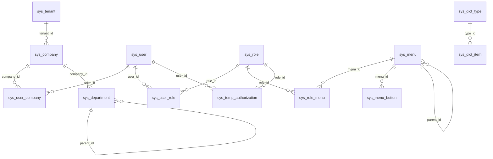

# 数据库设计（MySQL 8 · robot_cloud）

> 迁移文件：`robot-services/robot-system/src/main/resources/db/migration/`（Flyway 唯一写入者；已发布迁移不可变，变更新增 V3+）
> 规范：wl-skills-bd standards/12/29 —— lower_snake_case、禁 `is_` 列（统一 `*_FLAG`）、八列治理基线、索引按真实谓词。

## 1. 治理基线（每张业务表必备八列）

| 列 | 类型 | 约束 | 填充 |
|---|---|---|---|
| `id` | VARCHAR(64) | PK | 代码生成（不透明 String，禁数字自增防遍历） |
| `company_id` | VARCHAR(64) | NOT NULL（全局表除外） | 登录态公司，拦截器/审计填充 |
| `create_user_no` | VARCHAR(64) | NOT NULL | 登录名 / SYSTEM |
| `create_date_time` | DATETIME | NOT NULL | 服务器时间 |
| `update_user_no` | VARCHAR(64) | NULL | |
| `update_date_time` | DATETIME | NULL | |
| `delete_flag` | TINYINT(1) | NOT NULL DEFAULT 1 | **1=有效，0=删除**（jh4j profile 语义） |
| `revision` | INT | NOT NULL DEFAULT 0 | 乐观锁 `@Version` |

## 2. 表清单（V1 全量）

### 全局表（无 COMPANY_ID，白名单登记于 robot.mybatis.tenant.ignore-tables）

| 表 | 用途 | 关键列 | 索引 |
|---|---|---|---|
| `sys_tenant` | 租户 | tenant_name | UK(tenant_name) |
| `sys_company` | 公司（隔离键实体） | tenant_id, company_name, status_flag | idx(tenant_id) |
| `sys_user` | 平台用户 | username, password_hash(BCrypt), nickname, email, phone, department_id, status_flag | UK(username, delete_flag) |
| `sys_user_company` | 成员关系（ID=前端 contextId） | user_id, company_id, primary_flag, status_flag | idx(user_id), idx(company_id) |
| `sys_menu` | 菜单（前端路由唯一数据源） | parent_id, menu_type(directory/menu), menu_name, path, component, redirect, perm_code, icon, sort_no, visible_flag, keep_alive_flag, status_flag | idx(parent_id, sort_no) |
| `sys_role_menu` | 角色-菜单授权 | role_id, menu_id | idx(role_id), idx(menu_id) |
| `sys_menu_button` | 按钮权限 | menu_id, button_name, perm_code, sort_no, status_flag | idx(menu_id) |
| `sys_dict_type` | 字典类型 | type_code(UK), type_name | UK(type_code, delete_flag) |
| `sys_dict_item` | 字典项 | type_id, item_label, item_value, sort_no, status_flag | idx(type_id, sort_no) |

### 租户表（自动追加 company_id 过滤）

| 表 | 用途 | 关键列 | 索引 |
|---|---|---|---|
| `sys_department` | 部门树 | parent_id, dept_name, sort_no, status_flag | idx(company_id, parent_id) |
| `sys_role` | 角色 | role_name, role_code, data_scope(all/custom/department_below/department/self), sort_no, status_flag, remark | idx(company_id, role_code, delete_flag) |
| `sys_user_role` | 用户-角色绑定 | user_id, role_id | idx(user_id, company_id), idx(role_id) |
| `sys_temp_authorization` | 临时授权（30 天上限） | user_id, role_id, effect_from, effect_to, reason, status_flag | idx(user_id, effect_to) |
| `sys_permission_constraint` | 权限约束规则 | rule_name, rule_type, config_json, status_flag | idx(company_id, rule_type) |
| `sys_permission_audit_log` | 权限审计（只追加） | actor_user_no, action, target, detail | idx(company_id, create_date_time) |
| `sys_login_log` | 登录日志（V3，只追加） | user_id, username, login_type(login/activate/switch/refresh/logout), status_flag, ip, user_agent, login_time | idx(user_id, login_time), idx(company_id, login_time) |

## 3. 关系图

## 4. 种子数据（V2）

| 数据 | 值 |
|---|---|
| 租户/公司 | `tnt-default` 默认租户 / `cmp-robot` Robot 科技 |
| 部门 | 总公司 → 研发部 |
| 角色 | `SUPER_ADMIN` 超级管理员（data_scope=all）/ `SYS_ADMIN` 系统管理员（系统管理域菜单授权） |
| 用户 | `admin / admin123`（BCrypt；`usr-admin`，主公司 cmp-robot） |
| 菜单 | 首页/仪表盘/系统管理（用户/角色/菜单/字典，path 对齐 Robot_Admin 已注册路由） |
| 按钮码 | sys:user:save/delete、sys:role:save/delete、sys:menu:save/delete、sys:dict:save/delete |
| 字典 | user_status：1=启用 0=停用 |
| 约束 | 禁止自授角色 / 敏感操作二次确认 |

## 5. 软删与唯一性策略

- MP 逻辑删除全局启用（`logic-delete-field=deleteFlag`，1↔0）；业务代码统一 `removeById`/`delete(wrapper)`。
- 可恢复软删的唯一键冲突：业务表用「查询时显式 `delete_flag=1` 过滤 + 唯一索引带 delete_flag」的简化策略（UK(username, delete_flag)）；若未来出现「删后重建同键高频」表，按 standards/12 §4 升级为时间戳参与唯一键或部分索引方案（登记新迁移）。
- 审计日志只增不改不删，无 UPDATE 语句。

## 6. 变更流程（强制）

1. 文档表结构变更先改本文档（事实源），再写 `V{n}__desc.sql`（expand-only：新增可空列/兼容索引；破坏性操作走独立 contract 迁移 + 审批号）。
2. 已发布迁移**永不修改**；修复即新版本。
3. 生成 DDL 只进 Flyway，禁止先手工 ALTER 再补录（漂移必须取证后前向协调）。
4. 环境分级：local/dev 自动 migrate；test/pre 由流水线执行并留存 `reports/DDL_PREVIEW_*`；生产 DBA 审批窗口执行。
