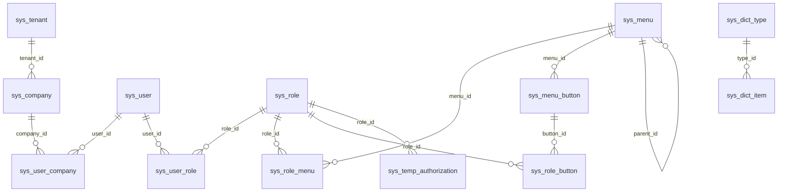

# 数据库设计（MySQL 8 · robot_cloud）

结构事实源为 `robot-services/robot-system/src/main/resources/db/migration/`。已发布V1–V5保持不可变，当前迁移至V10；本文描述迁移全部完成后的结构，实际环境核验范围见 [部署文档](deployment.md)。

## 治理与控制表

业务实体主键为VARCHAR(64)的不透明String。全局实体BaseEntity包含id、创建/更新人和时间、delete_flag、revision；TenantEntity另含company_id。CompanyId只取服务端身份，关系表的company_id仍需显式业务边界，不能因为在租户忽略清单内就省略授权。

| 列 | 当前类型与规则 |
| --- | --- |
| id | VARCHAR(64)，应用生成；不可把不可预测ID当作授权防线 |
| company_id | VARCHAR(64)，公司隔离键；全局表可无此列，成员关系保留关联公司列 |
| create_user_no/create_date_time | VARCHAR(64)/DATETIME，插入填充，更新保持 |
| update_user_no/update_date_time | VARCHAR(64)/DATETIME，插入与每次更新填当前操作者/时间 |
| delete_flag | TINYINT，默认1；1有效、0软删 |
| revision | INT默认0；编辑比较客户端版本，实际影响行数为0即冲突 |
| security_version | sys_user与sys_user_company的BIGINT默认0；会话撤销用，不由普通资料编辑版本替代 |

`sys_cache_epoch`、`sys_cache_outbox`是系统控制表，不继承业务治理实体。epoch是数据库权威版本；outbox允许更新投递状态，但不是只追加权限审计。`sys_permission_audit_log`仅经业务追加，登录日志则保持尽力而为。

## 表与主要索引（迁移后）

| 表 | 隔离与用途 | 主要列/约束 |
| --- | --- | --- |
| sys_tenant | 全局租户 | tenant_name唯一，status_flag |
| sys_company | 全局公司 | tenant_id索引，status_flag；公司ID是隔离键 |
| sys_user | 全局平台账号 | username、BCrypt password_hash、全局资料/department_id、status_flag、security_version；活跃username唯一 |
| sys_user_company | 全局关系表 | user_id/company_id/contextId、status_flag、primary_flag、security_version；活跃(company,user)唯一，每用户至多一个未删除primary |
| sys_department | 公司部门树 | company_id、parent_id、status_flag；索引(company,parent) |
| sys_role | 公司角色 | role_code/data_scope/status_flag；活跃(company,role_code)唯一 |
| sys_user_role | 公司角色绑定 | user_id、role_id；活跃(company,user,role)唯一 |
| sys_menu | 全局菜单 | parent_id、type、path、component、perm_code、sort_no、visible/keep_alive/status、remark；父级排序索引 |
| sys_menu_button | 全局按钮目录 | menu_id、perm_code、sort_no、status_flag、remark；菜单索引；精确权限码业务校验 |
| sys_role_menu | 全局关系表 | 活跃(role,menu)唯一；不自动附赠按钮 |
| sys_role_button | 全局关系表（V5） | 活跃(role,button)唯一；精确按钮授权 |
| sys_dict_type | 全局字典类型 | type_code/type_name/status_flag/remark；活跃type_code唯一 |
| sys_dict_item | 全局字典项 | type_id/item_code/item_label/item_value/status_flag/sort_no/remark；同类型活跃code、value分别唯一 |
| sys_temp_authorization | 公司临时角色授权 | user_id/role_id/effect_from/effect_to/reason/status_flag；当前实现半开时间窗和30天上限 |
| sys_permission_constraint | 公司约束配置 | rule_type/config_json/status_flag；目前供读取，没有通用规则执行器 |
| sys_permission_audit_log | 公司权限审计 | actor/action/target/detail；索引(company,create_time)；只追加 |
| sys_login_log | 公司登录日志（V3） | user_id/username/login_type/status/ip/UA/login_time；用户/公司时间索引 |
| sys_cache_epoch | system控制表（V6） | scope主键、version BIGINT；permissions和menu-tree初始化为1，字典按编码建命名空间 |
| sys_cache_outbox | system控制表（V6） | 事件kind/key/version、next_attempt_at、completed_at、attempts；pending索引(completed_at,next_attempt_at,created_at) |
| sys_cache_outbox_replay_log | 追加运维审计（V10） | event_id、actor_user_id、actor_company_id、受控reason、previous_revision/new_revision、created_at；索引(event_id,created_at) |

V10 为 outbox 增加 `delivery_revision BIGINT NOT NULL DEFAULT 0` 和 `last_failure_id VARCHAR(36)`。围栏版本用于投递确认、失败重排和人工重放的条件更新；与权限 epoch、通知携带版本、实体编辑版本职责不同。失败只保存允许的类别和随机关联 ID，不落原始异常消息或 payload。

当前公司管理员移出或停用的是sys_user_company，保留平台账号与其他公司成员。资料/密码仍在sys_user；共享账号只能由本人入口或未来独立平台能力管理，不把全局department_id描述成每公司部门档案。

图为应用关系，不表示DDL已经定义外键。代码和唯一索引共同保护关联；存量孤儿及跨公司绑定须在迁移前审查。

## 迁移与软删唯一性

| 迁移 | 变更 |
| --- | --- |
| V1–V5 | 初始化、种子、登录日志、按钮目录扩展和独立role_button |
| V6 | 持久epoch/outbox与菜单树锁行 |
| V7 | 账号/成员security_version，菜单/按钮remark；username和role_button改为仅未删除记录唯一 |
| V8 | 字典类型status、项独立code与remark；存量item_code由item_value回填；活跃字典code/value唯一 |
| V9 | 活跃角色码、成员、唯一primary、user_role、role_menu唯一 |
| V10 | 通知投递围栏、安全故障关联ID、追加重放审计；登记仅永久超管治理的精确按钮权限 |

V7–V9使用生成列：delete_flag=1时取业务键，否则NULL；唯一索引允许多条历史软删行。未删除但status=0的记录仍占业务键，primary唯一也包含未删除的停用成员。旧(username,delete_flag)或(role,button,delete_flag)策略已被替换，不能继续宣称可无限软删重建。

V7/V8先建立新的生成列唯一索引，成功后才DROP旧索引。迁移包含索引替换，不是纯新增且天然向后兼容的升级。MySQL DDL可能隐式提交，失败后不可假设整段自动回滚；需要在备份副本演练并留存Flyway状态、DDL结果和修复方案。默认关闭自动 baseline；非空无历史库必须先完成结构对账与迁移评审。

预检只读SQL、升级阶段和未验证边界见 [cache-and-dictionary-contract.md](cache-and-dictionary-contract.md)。历史冲突需业务裁决后独立处理，不在迁移中自动删授权或合并用户。

## 种子与部署

V2含默认租户/公司、admin示例账号、SUPER_ADMIN/SYS_ADMIN角色、页面及字典；V4/V5补充按钮与SYS_ADMIN精确绑定。默认凭据仅供隔离开发环境，生产启用前须更换并复核角色与权限。

数据库迁移和应用协议共同验收；本次token Session/family与必填revision协议需配套Admin和受控切换，旧客户端/旧镜像不能默认兼容。步骤见 [deployment.md](deployment.md)。投递完成的outbox记录留存、归档及清理仍待运维策略；不得把控制表自动填充或自动清理描述为已实现。
