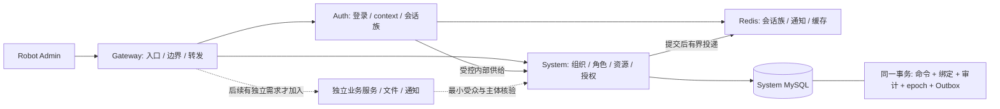

# Robot Cloud 全面审查与改进建议

审查日期：2026-10-14。项目：`com.robot:robot-cloud:1.0.0-SNAPSHOT`。源码基线：`29c42aae7dfbe9f72e2b7d2ee4d24ba209b2124f`，分支 `dev`。统一 BD runId：`0a6f9fd9-d3d4-4fac-aab0-1f0500d48f6b`。

**归档与复核说明。** 本文从同日完整审查记录整理进入项目文档。文中的“本轮”均指原只读审查，其构建和探针结果保留原验证范围。文档复核时 Cloud 业务源码仍为上述基线，原始清单的 110 个证据文件全部存在且 SHA-256 一致；只发现整改任务计划，没有后续修复提交或验收记录。REV01–REV24 均继续登记待处理，本文不是整改通过报告。当前进度以 [改进台账](improvement-roadmap.md) 为准。

配套Admin合同对比基线：`2cb90509edd13b57595e7425813a992c842f2d8e`，工作树干净；本轮只做相关源码/实际Vue Router比较，未运行其全量verify或浏览器E2E。

本轮根据对话中的 Robot Cloud 目标审查；IDE 打开的 wl-produce 文件不是本轮审查对象。审查只读业务源码，构建、探针与报告生成均已实际执行。没有实施下面的整改，没有提交项目变更，没有连接真实 MySQL/Redis/Nacos 或生产系统。

## 1. 结论与决策

**目前是有明确安全和事务设计的三服务后端基座，架构方向合理，但仍存在必要整改，不能认定代码、Admin 配对、规范门禁和生产运行均已闭环。** 现有测试通过，与本轮独立探针发现真实缺陷并不矛盾：部分关键行为没有进入正式回归，机器契约也仅覆盖子集。

下一轮优先解决权限目录边界、生产配置、密码字节规则、菜单实际持久化与路由身份、Admin 契约、刷新响应时序、持续质量门禁。性能优化先补测量，再决定请求内复用、公司级 epoch、Outbox 领取/并发和索引；当前没有证据支持直接上更多微服务、全局分布式事务或更多抽象层。

推荐保留 Gateway / Auth / System：Gateway 负责入口与转发，Auth 负责会话生命周期，System 负责身份组织与授权业务事实。**角色、绑定、成功审计、权限 epoch、Outbox 应继续留在同一数据库事务。** 以后拆通知、文件、独立业务域，应先有数据属主、契约、最小服务身份、撤销语义和运行验收，见第 7 节。

交付给执行 AI 的分批任务与验收见 [execution-plan.md](review-execution-plan.md)。专项细节与探针见 领域与数据库报告（原始归档）、安全报告（原始归档）、架构与性能报告（原始归档）。

## 2. 实际审查与验证范围

### 2.1 基线与检查结果

| 项目 | 本轮实际结果 | 不能据此推导的结论 |
| --- | --- | --- |
| 工程 | 14 个 Maven 模块；190 个 main Java、58 个 test Java 文件 | 文件数量不代表业务覆盖率 |
| 后端统一验证入口 | `scripts/verify.sh`：BUILD SUCCESS；55 份 XML，305 项 Java 测试，0 失败/错误/跳过；23 项 Python 测试通过 | 没有执行本轮 MySQL upgrade profile 或真实三服务联调 |
| 打包后装配 | 17 个 Mapper、68 个基础 mapped statements 检查通过 | 不证明全部自定义 SQL、目标 MySQL 执行计划和生产装配 |
| 开发工具 | 16 项真实工具/hook 行为测试通过；提交格式范围检查通过 | 格式检查未限制两父提交，见 REV17 |
| 工具链 | Maven 3.9.16；本轮 JDK 21.0.12，编译 release 17 | 没有本轮 JDK17 运行证据；CI 的 Java17 job 未成功验证 |
| 专项实验 | 当前编译类的 H2/Mapper、MVC、Vue Router 内存实验；BCrypt/网关/认证实验；真实 AuthSessionManager 状态时序见证 | 替身、H2、无监听 context 不等于真实 MySQL、入口 HTTP/2、浏览器、HA 和压测 |
| GitHub 托管 CI | 当前 SHA 的三个 Actions run 均为 failure | job 详情因公共 API 限额无法读取；不能沿用历史账号限制作为当前失败原因 |
| 工作树 | 本轮未修改业务源码，结束复核 HEAD 未变、工作树干净 | 报告在仓库外 output 中，整改尚未执行 |

第一遍验证受宿主沙箱禁止监听临时测试端口影响；重新取得该测试操作的执行权限后，同一入口通过。失败日志与成功日志都保留，不能把宿主限制当作源码回归，也不能删掉失败记录。历史 2026-10-09 的 308 测试含不同验证范围；本轮默认入口的 305 项不包含 3 项 MySQL 升级验收，不能把历史运行证据换算成本轮通过。

证据：verify.log（原始归档）、summary.json（原始归档）、55 份测试报告（原始归档）、工具测试（原始归档）、证据索引（原始归档）。当前托管回执示例：[Actions run 38131320137](https://github.com/ChenyCHENYU/Robot_Cloud/actions/runs/38131320137)，原始列表见 github-runs.json（原始归档）。

### 2.2 wl-skills-bd 的适用口径与真实回执

项目明确接入 `@agile-team/wl-skills-bd 0.37.0`。按项目 AGENTS 和 Robot 映射使用通用分层、命名、权限、事务、SQL、缓存、配置、测试、交付规范；**不套用 JH4J 类库/目录、Java8、平台响应码、平台分页基类或强制代码生成**。本轮显式路由 `convention-audit-be`，模式 inspect，业务写入未授权；同一个 runId 贯穿 task、检查和 status。

| 实际工具 | 结果 | 解释 |
| --- | --- | --- |
| `bd check` / `doctor-host` | 0.37.0 托管资产无漂移；静态宿主版本一致 | 宿主自动发现/实际加载仍未验证 |
| 全量 native validate | B1–B32 全部执行；278 个实际读取文件，70 个端点；74 error、0 warn，exit 1 | B1 70 条以 PreAuthorize 模型判断，不识别当前 Sa-Token；B17 4 条涉及软删调用和隔离事务回滚测试中的 DROP，需要语义适配 |
| 全量 native review | 基线 74，新增 0、阻断 0，32 条覆盖完整 | new-only 不阻断不等于已有风险修复，也不证明权限正确 |
| Robot generic gate | B2–B32 共 31 条；4 条 B17 基线、0 新增阻断 | B1 被排除并保留原始证据；必须由 Sa-Token 装配和行为门覆盖，不得长期无替代 |
| config doctor | 9 项中 1 通过、8 error | 对多模块 Boot3 ConfigData、Robot profile 不完整适配；把 Sa-Token 名称/样式和临时 CI 库密码当秘密，不能机械修为 JH4J 配置 |
| Java质量检查 | 项目已有 ArchUnit 实际执行；J2/J3/J4/J5/J8 未接入 | doctor 以文件名判断 ArchUnit，会误报；已有架构测试也不能替代缺失质量/覆盖率门 |
| 最终同 runId status | `executionStatus=failed`、`validationStatus=failed`；`stale=false`、`outdatedChecker=false`；pending J1/J2/J3/J4/J5/J8 | J1 是 BD 收据未完成关联，项目 ArchUnit 本轮确实跑过；不能手工把 pending 改成 passed |

原始报告：task（原始归档）、最终全量 validate（原始归档）、最终全量 review（原始归档）、Robot 适配门（原始归档）、config doctor（原始归档）、doctor（原始归档）、最终 status（原始归档）。

还确认一个收据缺口：0.37.0 的全根输入快照不排除 Maven `target`，构建产物达到预算后省略 42 个文件；`check:bd` 写入自身 target 报告会使同 runId 变 stale。**实际扫描的 278 个检查文件快照完整，不能把输入快照预算与规则扫描覆盖混为一谈。** 全量最终检查在构建稳定后重新执行，结果保存到仓库外，最终 status 已 fresh，但仍 failed。见 门后 stale 回执（原始归档）。应修包的生成物快照边界和收据关联，不能靠删除失败记录、伪造状态或扩基线遮盖。

## 3. 已有设计值得保留

| 能力 | 本轮核对结果 | 维护要求 |
| --- | --- | --- |
| 有效角色事实源 | EffectiveRoleResolver 合并有效绑定与生效临时授权；停用/归属失效有代码复核 | API、菜单、按钮、数据范围继续共享事实；永久授予上界与临时有效使用权分开 |
| 精确按钮授权 | role_button 独立绑定；菜单授权不隐含全按钮；未知 ID 拒绝 | 修改资源目录不能绕过同一上界，见 REV01 |
| 主体与族实时核验 | access 摘要、账号/成员安全版本、公司/租户归属和凭据指纹核验；依赖故障关闭访问 | 不用旧 Session 的 superAdmin 快照或依赖异常成功回退提高命中率 |
| 会话并发 | 单族 CAS、一次性 ticket、条件注销；现有行为测试覆盖竞争和重放 | 优化响应时序时保留单胜和撤销语义 |
| 内部链路 | 网关清洗内部头、常量时间密钥、重复头拒绝、委托一致性、ThreadLocal 清理 | 生产密钥/网络与未来服务受众仍需补齐 |
| 写命令一致性 | 主要命令 CAS 与审计、DB epoch、Outbox 同事务；发送在事务外；持久状态围栏 | 不把副作用拆到非可靠 afterCommit 内存回调，或在 DB 锁内等待外部服务 |
| 数据范围 | 用户读取已落 SQL；非法部门/祖先/unknown/custom 失败关闭 | 通用治理引擎缺口不等于现有用户读取已泄漏 |
| 数据迁移 | V7–V9 已加入活跃生成列唯一约束，修复重复软删再建问题 | 发布过的迁移不改 checksum；新增验收同时覆盖新库与升级库 |
| 集合读取 | 用户/上下文/权限树已批量装配，未发现经典逐用户/逐菜单 N+1 | 重复主体 SQL、大集合和树复杂度需另外测量 |
| 运行观测 | Outbox 低基数指标、重放审计和错误脱敏已经接线 | 指标存在不代表看板、告警、恢复容量已验收 |

## 4. 发现索引与优先级

P0 是特定授权/生产开放条件下的先决边界；P1 是下一轮交付或生产前验收重点；P2 是局部正确性、工程适配或需测量的容量改进。**P2 里菜单/路由这种已复现小缺陷应放早期短批次，不能按风险级别把它们无限后移。** “待验证”不表示已发生事故；“已复现”指下面写明的独立环境。

| ID | 级别 | 必要改进 | 证据类型 | 旧计划关系 |
| --- | --- | --- | --- | --- |
| REV01 | 条件 P0 | 全局目录写入与权限编码治理 | 源码完整数据流；未穿透 HTTP | N01 仍成立 |
| REV02 | P1，生产开放前 | 生产配置/内部凭据/种子/管理/环境护栏 | 源码；管理端点 context 反证 | N02，细化 |
| REV03 | P1 | 密码 UTF-8 字节边界 | 当前真实 BCrypt/DTO/Service 探针 | N03 重证；补官方公告 |
| REV04 | P2 | 敏感模型字符串输出 | 四个编译模型实际输出 | N03 重证 |
| REV05 | P2 | 请求实际字节与字段边界 | SCG filter、MVC Jackson 实验 | 新发现 |
| REV06 | P1/P2 | 认证滥用、失败审计和停用枚举 | 源码；真实 AuthService 失败实验 | N04；枚举是新增 |
| REV07 | P2 | 菜单根级 move/edit 不落库 | 真实 Service/Mapper/事务 + H2 | 新发现 |
| REV08 | P2 | 菜单全局路由名冲突 | 真实生成器 + 实际 Vue Router | 新发现 |
| REV09 | P2 | 可空字段清空与 Patch 语义 | 真实 Mapper + H2 | 新发现/合同需定义 |
| REV10 | P1，子项 P2 | Admin 用户/角色/治理/首页契约 | 双端源码；真实 MVC/成员读取 | N05 扩大，有新增 |
| REV11 | P1 | 资源删除/move 客户端 revision | 当前入口与命令源码 | N07 仍成立 |
| REV12 | P1 验收项 | 跨聚合引用竞争 | 源码顺序；真实 MySQL 待验 | N14 仍成立 |
| REV13 | P1，依多公司产品 | 公司成员部门事实 | 当前表与读取模型 | N08 仍成立 |
| REV14 | P1 | 会话轮换提交后响应预算 | 真实 manager 的 8 项时序见证 | 新发现 |
| REV15 | P1 | Java质量、覆盖率、契约和架构门 | pom/workflow/实际测试覆盖范围 | N10 与本轮细化 |
| REV16 | P2 | BD 平台适配与真实收据 | 原始 CLI 与快照状态 | 新细化 |
| REV17 | P1 | 托管 CI 与线性历史可执行门 | 当前托管 run；检查脚本源码 | N06；父数检查新增 |
| REV18 | P1 | 支持期、漏洞、供应链和工具链 | BOM + 官方支持/安全公告 | N09 重证 |
| REV19 | P2 | 身份读成本/全局 epoch/树/分页 | 静态调用路径；容量待测 | N11/N13 细化 |
| REV20 | P2 | Outbox 恢复容量/毒事件/留存/查询 | 消费与 SQL/index 结构 | N11 细化 |
| REV21 | P2 | DB 总预算与重试统一时钟 | 当前配置与 SQL | 新细化 |
| REV22 | P1，生产前 | 当前制品运行、HA、SLO、发布/备份 | 本轮环境证据缺口 | N12 仍成立 |
| REV23 | P2，新增服务前 | 最小服务身份/必需主体核验/内部依赖 | 当前装配边界与未来准入 | N13 细化 |
| REV24 | P2 | 脱敏诊断与业务结果指标 | 当前异常处理源码 | 新细化 |

## 5. 业务、安全、功能与契约

### REV01：全局资源目录可以改变已有绑定的授权含义

菜单、按钮、字典是全局事实。Controller 只要求可委托的目录动作权限；MenuService 接受 permission 并改写 permCode；RobotStpInterface 又根据已绑定资源的**当前权限码**计算权限。资源 ID 的授予上界阻止普通角色重绑更多 ID，却没有阻止其改写已经绑定 ID 的含义。

触发条件是普通管理员已获目录编辑动作且某可编辑资源被其角色绑定；改变该资源权限码可能获得新动作，也影响其他公司的共享绑定。精确格式校验与按钮唯一性限制部分编码，不能排除菜单权限码路径。没有进行真实鉴权攻击，不能说任意普通用户默认均可提权。

证据：[MenuController.java:73](../robot-services/robot-system/src/main/java/com/robot/system/menu/controller/MenuController.java#L73)、[MenuService.java:337](../robot-services/robot-system/src/main/java/com/robot/system/menu/service/MenuService.java#L337)、[RobotStpInterface.java:136](../robot-services/robot-system/src/main/java/com/robot/system/permission/service/RobotStpInterface.java#L136)、[现有 N01 数据流](improvement-roadmap.md#n01-全局资源目录写入与权限编码治理)、领域报告最后的全局目录条目。

先定义**平台目录属主的永久权威身份**；公司角色中的 SUPER_ADMIN 不能自动等同全平台管理资格。服务层统一限制目录所有命令与权限编码/启停语义修改；如需普通运营编辑图标/名称，提供单独展示命令。已绑定编码变更须走影响预览、迁移和成功审计。验收普通编辑者、仅临时超管、跨公司写均拒绝且无业务/审计/epoch/Outbox变化；合法平台写与失败回滚保持一致。

### REV02：把生产运行条件从文档转为可执行约束

默认 local、开发内部密钥回退、开发数据源、可选 Nacos 导入、自动 V2 管理员种子仍存在，缺统一生产模式启动校验。若开发 secret 未替换且 System 可直连，共享服务身份可访问内部凭据供给；本轮没有确认生产仍用默认值或端口对外开放。

管理反证：当前实际 SCG4.1.5 默认 `/actuator/gateway/routes` 为 404，**没有证实默认匿名路由写/SSRF**；Prometheus 匿名 200，显式启用 gateway endpoint 后匿名 routes 200。GlobalFilter 不保护 management handler。环境 key 读 ROBOT_ENV/JVM 属性，Spring profile 不自动绑定；规范化名称可碰撞，Sa-Token 自身 key 未接这一前缀，需真实环境隔离验证。

详见 SEC-C01–C03（原始归档）。生产启动应拒绝缺失/开发占位配置，明确内部网络、管理访问、Redis隔离、迁移/运行账号和 bootstrap 凭据交付。**不改 V2 checksum、不贸然删除已有管理员、不靠配置注释宣称固定种子已关闭。** 用新增迁移/受控初始化状态与上线流程证明开发凭据不可用于开放业务。真实 remote 合成配置也必须验收。

### REV03–06：密码、输出面与匿名入口

- **REV03 已复现**：25 个字符、73 UTF-8 字节密码通过现有校验；前72字节相同、后缀不同在实际 BCrypt6.2.8 交叉匹配，负例前缀变化拒绝。统一所有新密码 Service/DTO 的字符和字节规则，不自动截断；存量超长凭据策略单独审定。Spring 官方 [CVE-2025-22228](https://spring.io/security/cve-2025-22228/) 涵盖6.2.8所在区间，项目业务入口调用 passwordEncoder.matches；25字符/73字节这一具体可达性仍由本轮校验与实际依赖实验确认，不能仅据公告的72字符表述推导。升级需兼容整个 BOM，不盲填只有商业渠道的补丁版本。见 SEC-01（原始归档）。
- **REV04 已复现**：PasswordChangeRequest、UserSaveRequest、RemoteUserDTO、SysUser 的 toString 包含合成密码/摘要；重置 DTO 已隐藏，不能说所有 DTO 泄漏。未证明默认日志已泄密。字段排除与嵌套输出负例应进入回归，不能删掉认证所需 JSON 字段。见 SEC-05。
- **REV05 已复现**：相同5MB+1 body 带 Content-Length 得413，不带时实际 RequestSize filter 继续转发；实际登录 MVC 也接受超过5MB的 JSON，DTO无长度拒绝。应限制实际流式读取总字节，服务独立防线与字段上限并存。外部代理是否另有限制未验证，没有做崩溃/HTTP2压测。见 SEC-02。
- **REV06 源码缺口与新实验**：没有应用级跨实例账号/来源失败窗口，失败登录不记录事件；同一错误密码可区分停用账号与未知/启用账号。补有界门控、可恢复策略、脱敏失败审计，并统一凭据未验证前的公开失败合同。不能通过永久锁号让攻击者制造拒绝服务；公司发现也应共同评审。见 SEC-03/04。

### REV07–09：成功响应必须对应实际持久化和可用路由

**REV07 已复现**：子菜单拖到根级 before，或编辑提交空 parentId，真实 MenuService/Mapper 返回成功，但 MP 默认 NOT_NULL 省略 parent_id，数据库仍保留旧父级，revision推进；after走同一更新分支，但本轮没有单独运行。成功记录器被调用；探针的记录器是 spy，未证明实际审计、epoch、Outbox已持久化。应针对确定可清空 parent_id 明确 SET NULL，保留树锁与客户端CAS，不全局改ALWAYS。覆盖两侧排序、路由绝对路径、失败回滚，见 D01 与真实 SQL（原始归档）。

**REV08 已复现**：A/index、B/index 都是合法菜单，生成相同全局 name=Index；实际 Vue Router 注册第二条会移除第一条。以稳定菜单ID生成全局唯一身份，并与静态路由分命名空间；绝对有效路径也单独查冲突。验收组件缓存、撤权删除与静态路由，不只检查菜单树响应，见 D02。

**REV09 合同缺口，存储行为已证实**：用户 email/phone/departmentId 显式null被更新SQL跳过，其他列/revision却可能推进。先明确字段省略、null、空串语义；如果null代表保留，变更判定也要一致；如果代表清空，仅授权字段显式SET NULL。不能直接把清空部门后的范围风险写为已证实越权，见 D04。

### REV10：Admin 配对仍是实际交付瓶颈

| 子用例 | 当前差异/证据 | 必须达成的结果 |
| --- | --- | --- |
| 用户移出/启停/重置、角色删除 | Admin仍缺后端要求的 expectedRevision；源码复验 | 列表/详情保留账号与成员revision；有效版本成功、旧页面冲突，不自动拿最新版本覆盖 |
| 临时授权创建 | Admin按角色附加permissions，后端按userId+roleId授予现有角色；真实MVC拒绝Admin payload | 先选产品模型，再统一字段、时间、返回值、mock与remote |
| 提前撤回 | Admin调用PUT /sys/temp-authorizations/{id}/revoke，后端无mapping/用例 | 当前公司、授权revision、永久上界与精准撤销，同事务失效 |
| 数据权限保存/治理视图 | Admin PUT /sys/data-permissions/{id}无mapping；数据范围/约束/审计VO字段与页面不配对 | 支持能力保存→重读→实际SQL/VO执行；未实现部分清楚呈现，不能用摘要伪装已实现 |
| 角色成员 | 停用公司成员、活跃全局账号仍显示active；后端name/status字符串，Admin nickname/status数字 | 成员有效性来源明确；账号/成员开停矩阵与真实抽屉一致 |
| 无首页的合法角色 | 后端可只授权其他页面；Admin硬要求/home，否则路由初始化抛错 | 确认公共首页/必选首页/首个获授权落地策略，不能附送业务权限消除错误 |

详细两端源码和探针见 D03（原始归档） 与 governance-contract-probe.log（原始归档）。探针使用真实Controller/DTO/Advice，Admin错误payload返回 **HTTP200、业务code400**，缺路径为HTTP200、业务code404；不是实际HTTP400/404，也不是经过网关/鉴权/浏览器的完整端到端证据。

### REV11–13：命令并发意图、引用一致性与公司事实

**REV11**：菜单/按钮/字典删除只收ID，move版本可选；树锁保证服务器串行，不表达浏览器旧快照。补必需expectedRevision和CAS，前端同步；旧版本不得解绑/审计/推进epoch/Outbox，见D05。

**REV12**：角色删除count后软删，普通绑定/临时授权普通读角色后插入；成员移出与授予也缺统一事实行协调。Resolver过滤失效主体是一道安全边界，唯一约束不等于引用有效性。本轮未在实际MySQL用屏障复现悬空结果，应优先验真，再以稳定锁顺序/锁内重验解决。允许“授予先成功、随后移出撤销”的合法序列，保留两笔成功审计；只拒绝/回滚的事务不留成功记录。见D08，不能为追求单胜者删掉真实历史。

**REV13**：部门在全局sys_user而非sys_user_company，同账号两个公司不同部门无法表达；当前失配退本人，未证实泄漏。多公司产品需要成员主部门/多部门模型、Expand迁移、合法回填、对账和单写切换，不能复制某公司部门到所有成员。见D06。

## 6. 会话可恢复性、性能与工程门禁

### REV14：CAS已提交，新凭据响应仍等待同步审计/清理

AuthSessionManager 先CAS更新族，再同步清理、生成响应时同步Feign审计。刷新前还有账号/context两次RPC。8秒单RPC预算与15秒网关响应预算不保证总链路在入口15秒预算内完成。

真实manager见证在审计屏障期间确认：**新族已提交，响应未返回，旧access/refresh已失效**；释放后才返回可用新refresh。真实网关15秒触发尚未执行。降低非关键审计/索引清理在CAS后的同步预算，建立可靠且有界的事件投递；定义无法避免的网络丢响应恢复合同。不能恢复旧refresh或开放任意重放掩盖可用性缺口。见 ARCH-01（原始归档）、8项见证结果（原始归档）。

### REV15–18：测试通过之外的真实交付门

**REV15 Java质量和契约**：当前没有真实Checkstyle/PMD7/SpotBugs/Spotless/JaCoCo门；B9/B10/B11近似扫描不替代这些。ArchUnit当前覆盖common/API、Controller基础边界与服务隔离，Auth对应边界、System域内允许依赖/循环还可加强。先建立实际模块配置和代表性负样本，再接阻断；按BD14及项目映射落类级/分支/变更覆盖率，不能用总测试数量证明覆盖。

机器HTTP合同是users7+roles10共17路由，而端点清单70；数据库合同覆盖6表，不是20个建表的全部属性。缺陷行为、菜单/治理/会话/内网契约、新库/升级与打包Mapper要进入同一真实入口。按业务风险扩展，不能只新增不执行的JSON或镜像实现的断言。

**REV16 BD适配**：保留native74条事实；补Sa-Token/公开路由/inner校验识别及负例，校正B17软删/隔离测试、B25 Lombok、B29 Robot分页、B31 Robot事实合同；修Java17和generation-disabled profile、ArchUnit实际门收据、生成物快照。每项应有支持范围、负样本、执行证据，避免通过全局ignore或无理由基线实现假绿。具体回执见2.2。

**REV17 CI和线性历史**：workflow确已接构建、行为、升级、Mapper、工具与BD适配门；当前SHA托管run失败，原因未查明，分支保护未验证。不能用旧billing证据解释当前failure。另 [check_commits.mjs:22](../scripts/check_commits.mjs#L22) 只lint message，[commitlint.config.cjs:5](../commitlint.config.cjs#L5) 忽略Merge标题，未检测parent数。应对历史边界之后所有新增提交拒绝两个以上parents，并实际验证main/dev保护；本地merge.ff配置不能约束所有克隆。遵守用户feature→dev→main线性集成，不重写历史。

**REV18 支持期/供应链**：Boot3.2.12是3.2最后OSS补丁，当前Spring Cloud页面将2023.0列为EOL；实际Security6.2.8落在上述官方安全公告影响版本区间。本轮只核这一具体公告，**没有完整依赖漏洞扫描/SBOM结果**。应验证Boot/Cloud/Alibaba联合兼容矩阵、升级路线、CVE与许可证策略、SBOM和固定工具链。不要把旧分支存在解释为上游继续受支持，也不把2025.x名字当作必然受支持。BOM内springdoc兼容注释也需校准，当前2.3本身在Boot3.2官方兼容范围。

官方依据：[Boot3.2.12公告](https://spring.io/blog/2024/11/21/spring-boot-3-2-12-available-now/)、[Cloud当前支持表](https://spring.io/projects/spring-cloud/)、[Alibaba分支兼容关系](https://github.com/alibaba/spring-cloud-alibaba)、[springdoc兼容矩阵](https://springdoc.org/v2/#what-is-the-compatibility-matrix-of-springdoc-openapi-with-spring-boot)。兼容关系不等于维护承诺；新目标版本须按实际可用GA、支持期和运行回归选定。

### REV19：读成本、失效范围与管理容量应先测量

限定有效主体、一次权限计算且载荷命中的用户列表静态路径约11个身份/epoch SQL调用点，miss特定分支约23；Auth受保护聚合还有2次主体RPC+1次业务RPC。**这是静态调用点，不是所有请求的实测SQL次数。** 请求内主体复用、精确context核验契约可降低重复，但写事务内关键事实重验不能移除，不能跨请求缓存旧超管/epoch换性能。

全局permissions epoch让所有公司写争用同一控制行，A公司变更也失效B公司权限key；miss缺重建合并、旧key依TTL留存。先测锁等待、变更后回源、key/内存，再评估全局资源epoch+公司授权epoch。菜单/部门树残留重扫，DepartmentService结构O(N²)，深链无边界；DataScope后代查询已是分组+BFS，不能重复要求修它。

角色成员先取整公司集合，临时授权历史无分页，治理审计只最近500且更老不可查询；应结合界面设计改公司谓词join/exists、稳定分页/游标、宽深树算法与响应体预算。已有批量装配不是经典N+1。详见ARCH-04/05/09、D07；本轮未测p95/p99或EXPLAIN ANALYZE，不设虚构收益指标。

### REV20–21：Outbox正确性基础存在，长期恢复能力还要验

**REV20**：每轮最旧到期LIMIT100，串行处理，默认本轮结束后再等5秒fixedDelay；多worker不领取，可能重复发送，现有Lua/删除幂等与revision结果围栏仍有效，未发现现存重复消费造成非幂等错误。永久INVALID_EVENT和临时故障同样重试，需可审查隔离/告警。积压恢复吞吐、领取租约/分片/有界并发是否必要应以多实例曲线决定，不能机械加全局ShedLock把容量再压为单worker。

历史recent排序、pending扫描/排序、每轮全pending聚合的索引和执行计划待验；LIMIT只限返回数。完成历史无归档策略，需保留/重放/恢复责任与分批清理，严禁按创建时间直接删除pending或改旧迁移。详见ARCH-06/07。

**REV21**：重试nextAttempt用JVM LocalDateTime.now，到期判断用DB CURRENT_TIMESTAMP，zone/clock偏差时退避失真；现配置未验证统一合同。Hikari获取连接超时不限制后续driver网络、查询和锁等待，Dispatcher事务也没有总预算。先统一内部相对时间与DB session合同，再做网络黑洞/长查询/锁等待注入，验证连接回收和回滚；不要改掉Admin现有时间格式或仅靠Future.cancel。详见ARCH-02/03。

### REV22–24：运行保障、扩展准入与诊断

**REV22 生产前验收**：本轮未启动三服务，不证明当前制品本地完整链路；未重复真实MySQL升级、双System故障、Nacos/Sentinel、Admin页面、RedisHA、备份恢复或压测。历史Outbox故障SQL fixture不证明Redis全断时真实用户MVC仍可用；族校验失败关闭就是当前语义。需要明确目标容量、身份请求可用性/p95/p99、撤销/通知时延、积压恢复RTO、允许丢失RPO，再绑定当前源码与制品做真实演练。

Outbox指标已存在，但delivery timer不含前置DB扫描，startup零值/stale快照不是健康；补轮次/最后完成/快照年龄和依赖阶段观测，验证告警接收/恢复。HA回退、Redis旧快照、安全版本、备份对账、滚动发布/readiness/drain行为均需证据。不能把在线Redis不可用时跳过主体核验作为降级方案。

**REV23 扩展前约束**：common的[RedisSessionStateVerifier.java:57](../robot-common/robot-common-security/src/main/java/com/robot/common/security/session/RedisSessionStateVerifier.java#L57) 允许空subjectVerifiers流跳过持久主体复验；现Auth/System均有实现，**没有发现当前绕过**。新服务应在启动时要求明确核验策略/装配，区分普通主体状态供给与凭据摘要供给，采用最小服务受众和身份；增加相应ArchUnit负例与契约。当前共享inner secret不适合无边界复制给未来所有服务。

**REV24 诊断**：当前[GlobalExceptionHandler.java:119](../robot-common/robot-common-web/src/main/java/com/robot/common/web/handler/GlobalExceptionHandler.java#L119) 意外错误只记固定UNEXPECTED+traceId，敏感保护正确，但缺安全异常类型/可用诊断分类。Result错误多为HTTP200，单看HTTP成功率会掩盖业务失败。补低基数业务结果指标、受控异常类型和受限脱敏诊断通道，保留固定对外技术错误；不把原始Throwable、消息、SQL、token或请求恢复到普通日志。默认未启用circuitbreaker的fallback message sink只列潜在扩展风险，不宣称当前已泄露。

## 7. 未来迭代和拆分建议

先在System内部形成user/company-membership、role/grant、menu/resource、permission/cache、dictionary、audit查询的清晰依赖图与命令入口。查询模型可以独立组织；写命令继续由一个用例统筹需要原子提交的事实。不要为类行数把事务切碎，不为单实现提前加Service接口，不让公共组件引用业务实现。

拆分条件是独立数据属主、团队/交付节奏、容量/可用性需求和清楚的契约，而不是模块数量。首批更适合独立通知投递、文件资源、真正新增业务域；审计可异步导出/检索，但源成功审计仍随业务事务提交。角色/成员/权限事实和epoch/Outbox不宜在当前阶段拆开。

每个新服务必须带：受众与身份、主体即时撤销、租户/公司归属、契约兼容/错误模型、总deadline、缓存与幂等、数据迁移、可观测性和独立启动/故障验收。完成这些再决定数据库拆分或事件协议，避免将当前受控单库事务提前变成难以恢复的分布式写链。

## 8. 下一轮执行与复核方式

按 [执行计划](review-execution-plan.md) 分成可独立审查的小批次，每个问题先补有业务含义的失败用例，再做最小整改；涉及产品模型的任务先登记决定，不让AI自行发明临时授权或部门语义。新增配置、迁移与合同必须进真实验证入口。

每批回传：源码SHA/范围、实际命令与退出码、XML/原始报告、构建制品摘要、真实运行拓扑与结果、同runId BD status、未验证项。评审不能仅收“全部通过”摘要。新增提交遵守 `type(scope): message`，按feature→dev→main线性集成，验证两个remote同名主干一致；不改历史提交与迁移，不用扩大基线消除新增问题。

本报告不授予对生产/业务数据库的写入权限。真实迁移、故障注入、CI配置和远端分支保护需要执行环境的相应授权；只读审查与本地可回滚测试已经完成。未执行的生产/真实集成工作均在计划中作为验收项保留。

## 9. 原始记录位置与持续维护

原始记录保存在多项目工作区的 `output/robot-cloud-review-2026-10-14/`。这是本机取证位置，其他克隆不保证存在；本文保留完整发现与验收要求，仓库内阅读不依赖该目录。

| 归档项 | 相对原始目录的位置 |
| --- | --- |
| 原始总报告 / 执行计划 | `review.md` / `execution-plan.md` |
| 领域、数据库与 Admin 实验 | `domain/review.md` / `domain/probe-evidence.json` |
| 安全及配置实验 | `security/security-findings.md` |
| 架构、性能与认证时序 | `architecture/review.md` / `architecture/witness/` |
| 实际构建、测试、BD 与 CI 记录 | `evidence/` |
| 完整证据 SHA-256 索引 | `evidence/manifest.json` |

另一个 `output/robot-cloud-remediation-2026-10-14/` 目前只有任务路由回执。它证明已建立整改计划，不能证明任务已执行。

后续整改保留 REV 编号，更新台账中的状态、修复提交、适用测试、产品决定和目标环境证据。保持本报告的原审查基线与发现；不将历史测试改写为新版本通过，不通过删除待办或刷新质量基线表示修复完成。本次文档维护的原始检查回执位于 `output/robot-cloud-records-refresh-2026-10-14/`，与原审查收据分开保存。

## 10. 文档归档复核与 CI 补充

2026-10-14 文档维护复核了原始归档、当前源码和已安装规范。三项专项复核分别覆盖历史/架构交付、安全/认证、领域/数据库，未发现这些项目已有修复或需要新增缺陷编号。修改范围为 README、改进台账、本报告及执行计划；没有改变业务代码、配置、POM、合同或迁移，未重跑原审查的 Java/数据库/运行探针。

本次 runId 为 `41f534f8-623d-4673-80ea-462e2f5e1907`。实际 `wl-skills-bd 0.37.0` task 判定 `matched / convention-audit-be`；首次不支持的任务类型回执也保留。资产检查无漂移；完整 B1–B32 扫描读取 278 个检查文件，原生仍为 74 errors（B1 70、B17 4），完整基线 review 为 74 既有、0 新增、0 阻断；Robot B2–B32 门为 4 既有、0 新增、0 阻断。原始失败不改写为通过，J 门接入和宿主自动发现仍未验证。文档链接、24 项登记及修改范围另行检查。

CI 新读取证据：基线 SHA 的三个 run 仍为 failure，其中 [Verify Robot Cloud run 38131320137](https://github.com/ChenyCHENYU/Robot_Cloud/actions/runs/38131320137) 的 `verify` job（114446067171）steps 为空；其 [实际 annotation](https://api.github.com/repos/ChenyCHENYU/Robot_Cloud/check-runs/114446067171/annotations) 明确说明因账号计费锁定未启动。这补充了原审查第 2/6 节“当时原因未查明”的记录，不能由此推导其他 run 的原因，也不是源码构建失败或托管通过。需账号持有人处理后真实执行当前提交的验证；不通过改 workflow、跳过门禁或伪造收据解决账号限制。
